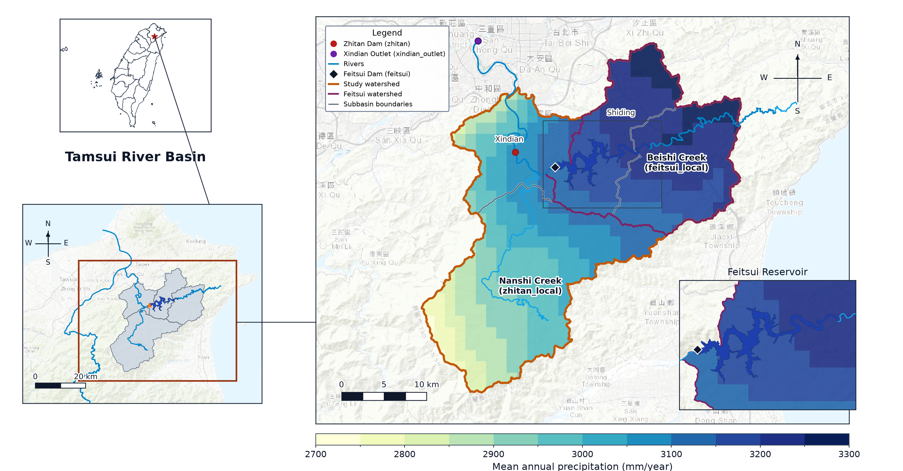

# Xindian River cascade (Taiwan) — Repository example

<div class="hero-band" markdown="1">

This **repository-only multi-reservoir example** (not part of the companion manuscript, which evaluates F.E. Walter Dam) models Taiwan's **Xindian River 2-reservoir cascade** — **Feitsui Reservoir** (`feitsui`) → **Zhitan Dam** (`zhitan`) → `xindian_outlet` — across one full out-of-sample year (**January 1 – December 31, 2025**, 365 daily steps). Using the same **HydroCNHS** (`GWLF` + `Lohmann`) 10-year C&V workflow and **unified seasonal-target decision-chain prompt** as F.E. Walter, it compares a dual **Rule-based** Hanasaki cascade (`rule_based.yaml`) against a **Hybrid LLM cascade** (`hybrid_llm.yaml`).

</div>

## Study area, 10-year HydroCNHS hydrology, and C&V

<figure class="figure-card">
  
  <figcaption><strong>Figure 5.</strong> Xindian River <strong>2-reservoir series cascade</strong>, subbasins (<code>U1–U2</code> feeding <code>feitsui_local</code>, 30,300 ha; <code>D1–D2</code> contributing <code>zhitan_local</code>, 37,680 ha), WRA gauges (<code>10205</code>, <code>10212</code>), and mean annual precipitation (WorldClim 2.1): <strong>1. Feitsui Reservoir</strong> (<code>335,505,000 m3</code>; <code>[0, 500] m3/s</code>) routes through a calibrated Lohmann unit hydrograph (<code>[0.919013, 0.080987]</code>) into <strong>2. Zhitan Dam</strong> (<code>1,918,900 m3</code>; <code>[0, 800] m3/s</code>) before discharging to <code>xindian_outlet</code>.</figcaption>
</figure>

Local incremental inflows ([`inflows.csv`](inflows.csv), `data_kind: simulated_local_inflow`) come from the 4-subbasin HydroCNHS model ([`hydrology/xindian_catchments.yaml`](hydrology/xindian_catchments.yaml), [`hydrology/hydrology.yaml`](hydrology/hydrology.yaml)) forced by 11 years of daily ERA5 weather ([`hydrology/forcing.csv.gz`](hydrology/forcing.csv.gz), 2015 warm-up) and evaluated over **10 years (`2016–2025`, 3,653 days)** against official Taipei Feitsui Reservoir Administration (TFRA) open records ([`hydrology/cv_summary.json`](hydrology/cv_summary.json)):

| Hydrology segment | Period | Days | KGE | NSE | RMSE (m³/s) |
| --- | --- | --- | --- | --- | --- |
| Calibration (`U1–U2` Feitsui inflow) | `2016-01-01`–`2022-12-31` (7 yr) | 2,557 | `0.549` | `0.559` | `33.63` |
| Validation (`U1–U2` Feitsui inflow) | `2023-01-01`–`2025-12-31` (3 yr) | 1,096 | `0.802` | `0.789` | `23.65` |
| Calibration (`D1–D2` Nanshi local flow) | `2016-01-01`–`2022-12-31` (7 yr) | 2,557 | `0.743` | `0.605` | `35.69` |
| Validation (`D1–D2` local / combined Zhitan) | `2023-01-01`–`2025-12-31` (3 yr) | 1,096 | `0.739` / `0.837` | `0.626` / `0.796` | `35.75` / `35.51` |

<div class="panel-grid panel-grid-2" markdown="1">
<div class="panel-card" markdown="1">

### Condition 1: Rule-based cascade

- **Config**: [`rule_based.yaml`](rule_based.yaml)
- **Method**: Dual **Rule-based** Hanasaki flood-control rule (`strategy: benchmark`, α = 0.85) calibrated on 7-year (`2016–2022`) TFRA statistics ([`feitsui_statistics.json`](feitsui_statistics.json), [`zhitan_statistics.json`](zhitan_statistics.json)), offline.
- **Result**: Ends 2025 at `197,210,215 m3` in `feitsui` (from `316,895,260 m3`) and `1,918,822 m3` in `zhitan` (`PASS`).

</div>
<div class="panel-card" markdown="1">

### Condition 2: Hybrid LLM cascade

- **Config**: [`hybrid_llm.yaml`](hybrid_llm.yaml)
- **Method**: Upstream `feitsui_operator` runs `gemma4:12b` (`strategy: xindian_study`, F.E. Walter seasonal-target decision-chain JSON in [`study/response_schemas.json`](study/response_schemas.json) with [`study/elevation_storage.csv`](study/elevation_storage.csv) via [`study/formatter.py`](study/formatter.py)), paired with downstream Hanasaki on `zhitan_operator`.
- **Prompts**: [System](prompts/feitsui.system.txt) · [Day-1 User sample](prompts/feitsui.user.txt).
- **Result**: Ends 2025 at `316,858,807 m3` (`168.06 m`) in `feitsui` and `1,918,715 m3` in `zhitan` (`PASS`).

</div>
</div>

## Configuration files and quick run

Both conditions share [`case.json`](case.json) and [`inflows.csv`](inflows.csv). Validate both configs and run the offline 365-day baseline:

```sh
reservoir-experiment check examples/multi_reservoir/rule_based.yaml
reservoir-experiment run examples/multi_reservoir/rule_based.yaml
reservoir-experiment verify runs/multi-reservoir-rule-based --require-offline
reservoir-experiment check examples/multi_reservoir/hybrid_llm.yaml
```

- **Inflow checksum**: After editing `inflows.csv`, update `inflow_source.sha256` in `case.json` with `python -c "import hashlib,sys; print(hashlib.sha256(open(sys.argv[1],'rb').read()).hexdigest())" examples/multi_reservoir/inflows.csv`.
- **YAML scientific notation**: Include `+` or `-` in exponents (`8.0e+6` or `8000000.0`), because YAML parses `8.0e6` as text and `check` rejects it.

For network schemas and custom prompts, see [Multi-reservoir networks](../../docs/MULTI_RESERVOIR.md) and [Rules & LLM prompts](../../docs/AGENT_DESIGN.md).

## Full-year 2025 performance (validation window)

<figure class="figure-card">
  
  <figcaption><strong>Figure 6.</strong> Daily 2025 Feitsui Reservoir water level (m), release (m³/s), and downstream Xindian River flow comparing TFRA observations against the Rule-based cascade and Hybrid LLM cascade (seasonal targets <code>168 m</code> Nov–Apr and <code>164 m</code> May–Oct).</figcaption>
</figure>

Across the 365-day validation year, `Hybrid LLM` follows the `168 m` / `164 m` seasonal rule curve closely (level `RMSE = 4.46 m`, `NSE = 0.035`), whereas `Rule-based` Hanasaki over-draws Feitsui (`RMSE = 6.90 m`, `NSE = -1.317`) while achieving smoother flood outflow attenuation (`Downstream flow KGE = 0.684`, [`study/expected_scores.csv`](study/expected_scores.csv)):

| Condition | Feitsui level KGE | Feitsui level NSE | Feitsui level RMSE (m) | Feitsui release KGE / RMSE (m³/s) | Downstream flow KGE / RMSE (m³/s) |
| --- | --- | --- | --- | --- | --- |
| Rule-based cascade (Hanasaki + Hanasaki) | `0.588` | `-1.317` | `6.90` | `0.414` / `35.30` | `0.684` / `56.34` |
| Hybrid LLM cascade (`feitsui` LLM + `zhitan` Hanasaki) | `0.410` | `0.035` | `4.46` | `0.439` / `45.06` | `0.497` / `71.21` |

## Reproduce offline or run with local Ollama

Replay the 365-day archived decisions ([`study/archived_releases.csv`](study/archived_releases.csv)) and Rule-based cascade offline (`0` network calls), or run live with Ollama (`gemma4:12b`):

```sh
python examples/multi_reservoir/study/replay.py --output runs/xindian-replay
reservoir-experiment run examples/multi_reservoir/hybrid_llm.yaml --allow-network
```

Inspect outputs with [Reading results](../../docs/RESULTS_GUIDE.md) or compare with the manuscript benchmark [F.E. Walter Dam](../fe_walter/README.md).
