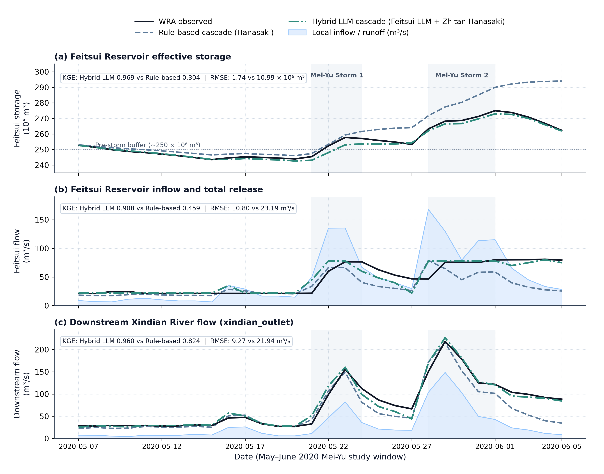

# Xindian River cascade (Taiwan)

<div class="hero-band" markdown="1">

This multi-reservoir case study models Taiwan's **Xindian River cascade** — **Feitsui Reservoir** (`feitsui`) → **Zhitan Dam** (`zhitan`) → `xindian_outlet` — across the **May 7 – June 5, 2020** Mei-Yu front (`2020-05-07`–`2020-06-05`, 30 daily steps) using historical inflow, storage, and release records from Taiwan's Water Resources Agency (WRA). It compares a dual **Rule-based** Hanasaki cascade (`rule_based.yaml`) against a **Hybrid LLM cascade** (`hybrid_llm.yaml`) on the same HydroCNHS routing network.

</div>

## Study area and benchmark design

<figure class="figure-card">
  
  <figcaption><strong>Figure 5.</strong> Xindian River <strong>2-reservoir series cascade</strong>, subbasins (<code>U1–U2</code> feeding <code>feitsui_local</code>; <code>D1–D2</code> contributing <code>zhitan_local</code>), WRA gauges (<code>10205</code>, <code>10212</code>), and mean annual precipitation (WorldClim 2.1): <strong>1. Feitsui Reservoir</strong> (<code>335,505,000 m3</code>; <code>[0, 500] m3/s</code>) routes through a <code>[0.8, 0.2]</code> lag into <strong>2. Zhitan Dam</strong> (<code>1,918,900 m3</code>; <code>[0, 800] m3/s</code>) before discharging to <code>xindian_outlet</code>.</figcaption>
</figure>

<div class="panel-grid panel-grid-2" markdown="1">
<div class="panel-card" markdown="1">

### Condition 1: Rule-based cascade

- **Config**: [`rule_based.yaml`](rule_based.yaml)
- **Method**: Dual **Rule-based** Hanasaki flood-control rule (`strategy: benchmark`, α = 0.85) on `feitsui_operator` ([`feitsui_statistics.json`](feitsui_statistics.json)) and `zhitan_operator` ([`zhitan_statistics.json`](zhitan_statistics.json)), offline.
- **Result**: Ends at `294,038,029 m3` in `feitsui` (from `253,810,100 m3`) and `1,639,737 m3` in `zhitan` (from `1,639,500 m3`, `PASS`).

</div>
<div class="panel-card" markdown="1">

### Condition 2: Hybrid LLM cascade

- **Config**: [`hybrid_llm.yaml`](hybrid_llm.yaml)
- **Method**: Upstream `feitsui_operator` runs `gemma4:12b` (`history_steps: 2`, `reservoir-action.v1`) paired with downstream Hanasaki on `zhitan_operator` ([`zhitan_statistics.json`](zhitan_statistics.json)).
- **Prompts**: [System prompt](prompts/system.txt) · [User template](prompts/operator.txt).
- **Result**: Ends at `261,903,700 m3` in `feitsui` and `1,639,936 m3` in `zhitan` (`PASS`).

</div>
</div>

## Configuration files and quick run

Both conditions share [`case.json`](case.json) (WRA capacities, `[0.8, 0.2]` unit-hydrograph routing, and `2020-05-07` initial storages) and [`inflows.csv`](inflows.csv) (32 daily local inflows from `2020-05-05` to `2020-06-05`, containing the 30-day study window). Validate both files and execute the offline baseline:

```sh
reservoir-experiment check examples/multi_reservoir/rule_based.yaml
reservoir-experiment run examples/multi_reservoir/rule_based.yaml
reservoir-experiment verify runs/multi-reservoir-rule-based --require-offline
reservoir-experiment check examples/multi_reservoir/hybrid_llm.yaml
```

The offline `rule_based.yaml` workflow verifies with `PASS` at `294,038,029 m3` in `feitsui` and `1,639,737 m3` in `zhitan` (change `run_id` and `output` before repeating). Keep two configuration rules in mind when customizing this cascade:

- **Inflow checksum**: If you edit `inflows.csv`, update `inflow_source.sha256` in `case.json` using `python -c "import hashlib,sys; print(hashlib.sha256(open(sys.argv[1],'rb').read()).hexdigest())" examples/multi_reservoir/inflows.csv`.
- **YAML scientific notation**: Always include `+` or `-` in exponents (`8.0e+6` or `8000000.0`), because YAML parses `8.0e6` as text and `check` rejects it.

For full network schemas, junctions, and custom prompt design, see [Multi-reservoir networks](../../docs/MULTI_RESERVOIR.md) and [Rules & LLM prompts](../../docs/AGENT_DESIGN.md).

## Mei-Yu storm performance (May–June 2020)

<figure class="figure-card">
  
  <figcaption><strong>Figure 6.</strong> Daily May 7 – June 5, 2020 Feitsui Reservoir storage, Feitsui release, and downstream Xindian River flow comparing Taiwan WRA historical observations against the Rule-based cascade and Hybrid LLM cascade.</figcaption>
</figure>

During the May 2020 Mei-Yu front, the dual Hanasaki baseline over-retains storm inflow in Feitsui Reservoir (ending near `294.0 × 10⁶ m³`), whereas the Hybrid LLM operator adapts upstream releases to match WRA flood-control drawdowns and sharpens downstream hydrograph timing at `xindian_outlet`.

Performance over `2020-05-07`–`2020-06-05` against Taiwan WRA observations (stored in [`study/expected_scores.csv`](study/expected_scores.csv)):

| Condition | Feitsui storage KGE | Feitsui storage NSE | Feitsui storage RMSE (10⁶ m³) | Feitsui release KGE / RMSE (m³/s) | Downstream flow KGE / RMSE (m³/s) |
| --- | --- | --- | --- | --- | --- |
| Rule-based cascade (Hanasaki + Hanasaki) | `0.304` | `-0.186` | `10.99` | `0.459` / `23.19` | `0.824` / `21.94` |
| Hybrid LLM cascade (`feitsui` LLM + `zhitan` Hanasaki) | `0.969` | `0.970` | `1.74` | `0.908` / `10.80` | `0.960` / `9.27` |

## Reproduce the reported scores offline

Replay the archived daily release series ([`study/archived_releases.csv`](study/archived_releases.csv)) and the Rule-based cascade against Taiwan WRA observations ([`study/observations.csv`](study/observations.csv)) offline:

```sh
python examples/multi_reservoir/study/replay.py --output runs/xindian-replay
```

Verification scores (KGE, NSE, and RMSE) are written to `runs/xindian-replay/scores.csv`.

## Make new runs with local Ollama

Start local Ollama with `gemma4:12b` available on `http://127.0.0.1:11434`, then execute the hybrid cascade with network access enabled:

```sh
ollama serve
```

In a second terminal (use a fresh `run_id` and `output` path in `hybrid_llm.yaml` before repeating):

```sh
reservoir-experiment run examples/multi_reservoir/hybrid_llm.yaml --allow-network
```

Because floating-point LLM inference varies across hardware, use `study/replay.py` above to reproduce the reported scores identically. Inspect outputs in [Reading results](../../docs/RESULTS_GUIDE.md) or compare with the single-reservoir [F.E. Walter Dam](../fe_walter/README.md) study.
