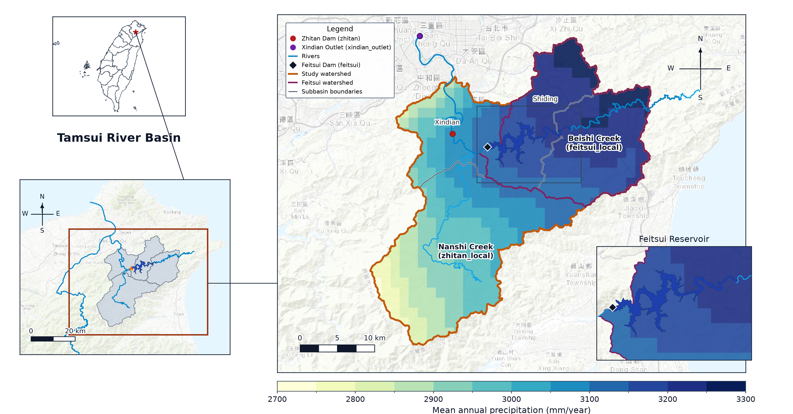
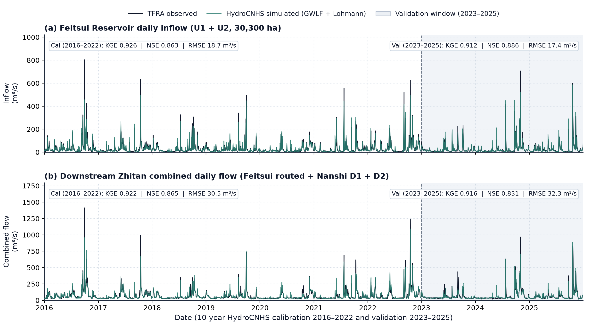
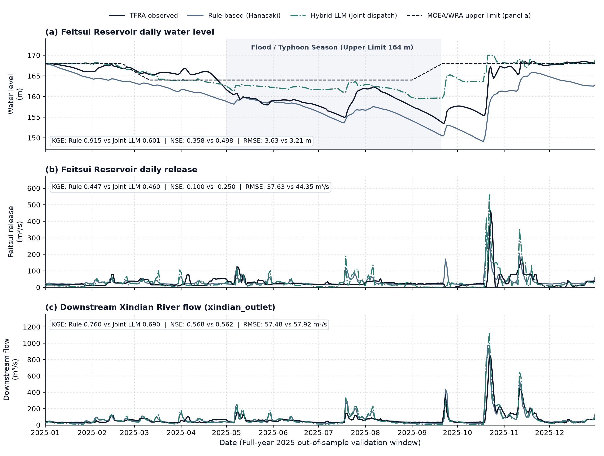

# 多水库串联案例：台湾新店溪翡翠水库 → 直潭坝（仓库专属示例）

<div class="hero-band" markdown="1">

本案例为**仓库专属示例（未收录于论文）**（论文主体实验为单水库 F.E. Walter），以台湾新店溪 **2 座水库串联系统**（**翡翠水库 `feitsui`** → **直潭坝 `zhitan`** → **`xindian_outlet`**）完成 **10 年（2016–2025）水文率定与验证（C&V）** 后，针对验证期末完整 **1 年（2025-01-01 – 2025-12-31，共 365 天）** 进行对比，评估**全规则串联（Hanasaki + Hanasaki）**与**联合供水调度混合式 LLM 串联（翡翠水库官方运用规线＋南势溪侧向入流 LLM + 直潭坝 Hanasaki）**两种操作条件。

</div>

## 研究区域、10 年 HydroCNHS 水文模型与 C&V

<figure class="figure-card">
  
  <figcaption><strong>图 5.</strong> 台湾新店溪<strong>双水库串联系统（2 座水库串联）</strong>、子集水区（<code>U1–U2</code> 汇入 <code>feitsui_local</code>，30,300 公顷；<code>D1–D2</code> 汇入 <code>zhitan_local</code>，37,680 公顷）、经济部水利署（MOEA/WRA）测站（<code>10205</code>、<code>10212</code>）与年均降雨分布（WorldClim 2.1）：<strong>1. 翡翠水库</strong>（<code>335,505,000 m³</code>，<code>0–500 m³/s</code>）经率定的 Lohmann 单位线（<code>[0.801305, 0.198693, 2e-06]</code>）衔接 <strong>2. 直潭坝</strong>（<code>1,918,900 m³</code>，<code>0–800 m³/s</code>），再经 <code>[1.0]</code> 流至 <code>xindian_outlet</code>。</figcaption>
</figure>

本示例的区域增量入流（[`inflows.csv`](inflows.csv)，`data_kind: simulated_local_inflow`）由 4 子集水区 HydroCNHS 模型（[`hydrology/xindian_catchments.yaml`](hydrology/xindian_catchments.yaml)、[`hydrology/hydrology.yaml`](hydrology/hydrology.yaml)）驱动翡翠水库管理局（TFRA）`145840` 官方实测集水区日雨量与 ERA5 气温／PET（[`hydrology/forcing.csv.gz`](hydrology/forcing.csv.gz)，含 2015 年预热），并以内置 **`GA_DEAP` + Powell** 对照 **2016–2025 年共 10 年（3,653 天）翡翠水库管理局（TFRA）官方观测记录** 完成 7 年率定与 3 年样本外验证（[`hydrology/cv_summary.json`](hydrology/cv_summary.json)）：

| 水文阶段 | 期间 | 天数 | KGE | NSE | RMSE (m³/s) |
| --- | --- | --- | --- | --- | --- |
| 率定期 Calibration（`U1–U2` 翡翠入库流量） | `2016-01-01`–`2022-12-31`（7 年） | 2,557 | `0.926` | `0.863` | `18.73` |
| 验证期 Validation（`U1–U2` 翡翠入库流量） | `2023-01-01`–`2025-12-31`（3 年） | 1,096 | `0.912` | `0.886` | `17.38` |
| 率定期 Calibration（`D1–D2` 南势溪区间流） | `2016-01-01`–`2022-12-31`（7 年） | 2,557 | `0.839` | `0.711` | `30.53` |
| 验证期 Validation（`D1–D2` 区间 / 直潭组合流量） | `2023-01-01`–`2025-12-31`（3 年） | 1,096 | `0.844` / `0.916` | `0.684` / `0.831` | `32.86` / `32.30` |

<figure class="figure-card">
  
  <figcaption><strong>图 6.</strong> HydroCNHS 十年日流量率定（<code>2016–2022</code>）与样本外验证（<code>2023–2025</code>，灰底）对照翡翠水库管理局（TFRA）官方观测记录：<strong>(a)</strong> 翡翠水库入库流量（<code>U1–U2</code>）；<strong>(b)</strong> 下游直潭坝组合流量（翡翠演进下泄汇入南势溪 <code>D1–D2</code> 侧向入流）。</figcaption>
</figure>

<div class="panel-grid panel-grid-2" markdown="1">
<div class="panel-card" markdown="1">

### 情境一：全规则串联（Rule-based）

- **配置文件**：[`rule_based.yaml`](rule_based.yaml)
- **方法**：上下游均采 Hanasaki 防洪规则（`strategy: benchmark`，α = 0.85），依 7 年率定期（`2016–2022`）官方观测入流统计 [`feitsui_statistics.json`](feitsui_statistics.json) 与 [`zhitan_statistics.json`](zhitan_statistics.json) 离线运行。
- **期末蓄水量**：翡翠水库结束于 `271,292,850 m3`（`162.77 m`，由 `316,895,260 m3` 出发）、直潭坝结束于 `1,918,697 m3`（`PASS`）。

</div>
<div class="panel-card" markdown="1">

### 情境二：混合式 LLM 串联（联合供水调度）

- **配置文件**：[`hybrid_llm.yaml`](hybrid_llm.yaml)
- **方法**：上游翡翠水库（`feitsui_operator`）由 `gemma4:12b` 操作（`strategy: xindian_study`，依据经济部水利署（MOEA/WRA）《翡翠水库运用要点》运用规线上限 `168 m / 164 m` 并实时接收下游南势溪侧向入流 [`study/formatter.py`](study/formatter.py) 进行直潭联合供水调度，采用统一决策链 JSON [`study/response_schemas.json`](study/response_schemas.json) 与 [`study/elevation_storage.csv`](study/elevation_storage.csv)），搭配下游直潭坝（`zhitan_operator`）Hanasaki 规则。
- **提示词**：[System prompt](prompts/feitsui.system.txt) · [第 1 天 User 示例](prompts/feitsui.user.txt)。
- **期末蓄水量**：翡翠水库结束于 `321,867,597 m3`（`168.73 m`）、直潭坝结束于 `1,918,607 m3`（`PASS`）。

</div>
</div>

## 配置文件与快速检查

两组条件共用 [`case.json`](case.json) 与 [`inflows.csv`](inflows.csv)（含 `2024-12-30`–`2025-12-31` 共 367 天模拟入流，涵盖 2025 全年 365 天操作；[`reference_inflows.csv`](reference_inflows.csv) 收录 `2016–2022` 年共 2,557 天官方观测流量）。离线检查并运行全年全规则串联基准：

```sh
reservoir-experiment check examples/multi_reservoir/rule_based.yaml
reservoir-experiment run examples/multi_reservoir/rule_based.yaml
reservoir-experiment verify runs/multi-reservoir-rule-based --require-offline
reservoir-experiment check examples/multi_reservoir/hybrid_llm.yaml
```

- **编辑入流与 YAML 规则**：修改 `inflows.csv` 后请运行 `python -c "import hashlib,sys; print(hashlib.sha256(open(sys.argv[1],'rb').read()).hexdigest())" examples/multi_reservoir/inflows.csv` 更新 `inflow_source.sha256`；YAML 科学记数法务必加上 `+`/`-`（如 `8.0e+6`）。
- **详细配置指南**：水库串联字段见[多水库河网串接](../../docs/MULTI_RESERVOIR.zh-CN.md)，提示词与规则设计见[操作规则与 LLM 设计](../../docs/AGENT_DESIGN.zh-CN.md)，论文单库基准见[F.E. Walter 水库案例](../fe_walter/README.zh-CN.md)。

## 2025 全年模拟表现（样本外验证年）

<figure class="figure-card">
  
  <figcaption><strong>图 7.</strong> 2025 全年（365 天）翡翠水库水位（m）、下泄流量（m³/s）与新店溪下游流量模拟结果，仅绘制翡翠水库管理局（TFRA）官方观测记录、全规则串联（Hanasaki + Hanasaki）与联合调度混合式 LLM 串联三条序列；(a) 面板同步叠加绘制经济部水利署（MOEA/WRA）官方 36 旬运用规线上限（完整上限／中限／下限／严重下限收录于 <a href="study/rule_curve.csv"><code>study/rule_curve.csv</code></a>）。</figcaption>
</figure>

在完整 365 天验证模拟中，**联合调度混合式 LLM 串联**取得比全规则基准更低的水位误差（水位 `RMSE = 3.21 m`、`NSE = 0.498`，全规则为 `3.63 m` / `0.358`），同时下游总流量 `RMSE` 与全规则几近相当（`57.92` vs `57.48 m³/s`）；而**全规则 Hanasaki** 则呈现最高的翡翠水位与下游流量相关结构（`KGE = 0.915` / `0.760`，逐项指标见 [`study/expected_scores.csv`](study/expected_scores.csv)）：

| 操作条件 | 翡翠水位 KGE | 翡翠水位 NSE | 翡翠水位 RMSE (m) | 翡翠下泄流量 KGE / RMSE (m³/s) | 下游流量 KGE / RMSE (m³/s) |
| --- | --- | --- | --- | --- | --- |
| 全规则串联（Hanasaki + Hanasaki） | `0.915` | `0.358` | `3.63` | `0.447` / `37.63` | `0.760` / `57.48` |
| 混合式 LLM 串联（联合调度 LLM + 直潭 Hanasaki） | `0.601` | `0.498` | `3.21` | `0.460` / `44.35` | `0.691` / `57.92` |

## 离线复现或使用本地 Ollama 实时重跑

通过水库水量平衡引擎与河道演进离线回放 365 天归档下泄序列（[`study/archived_releases.csv`](study/archived_releases.csv)），或在本地启动 `ollama serve`（需已下载 `gemma4:12b`）重新运行实时模拟：

```sh
python examples/multi_reservoir/study/replay.py --output runs/xindian-replay
reservoir-experiment run examples/multi_reservoir/hybrid_llm.yaml --allow-network
```

输出解读请见[结果解读与水量平衡](../../docs/RESULTS_GUIDE.zh-CN.md)。
