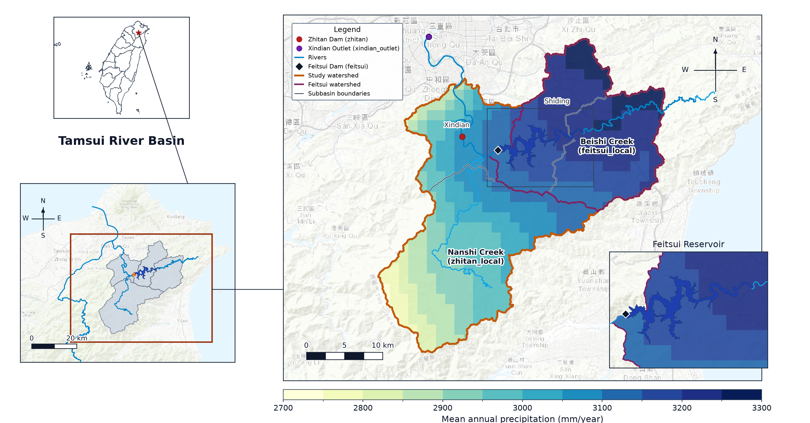
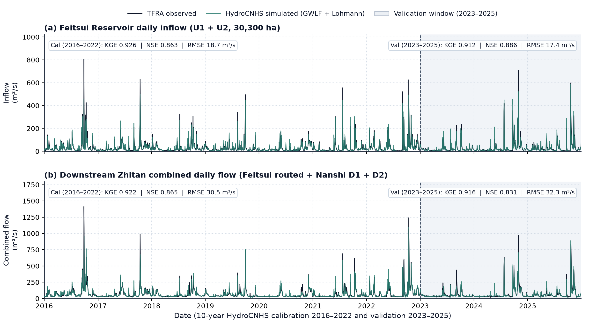
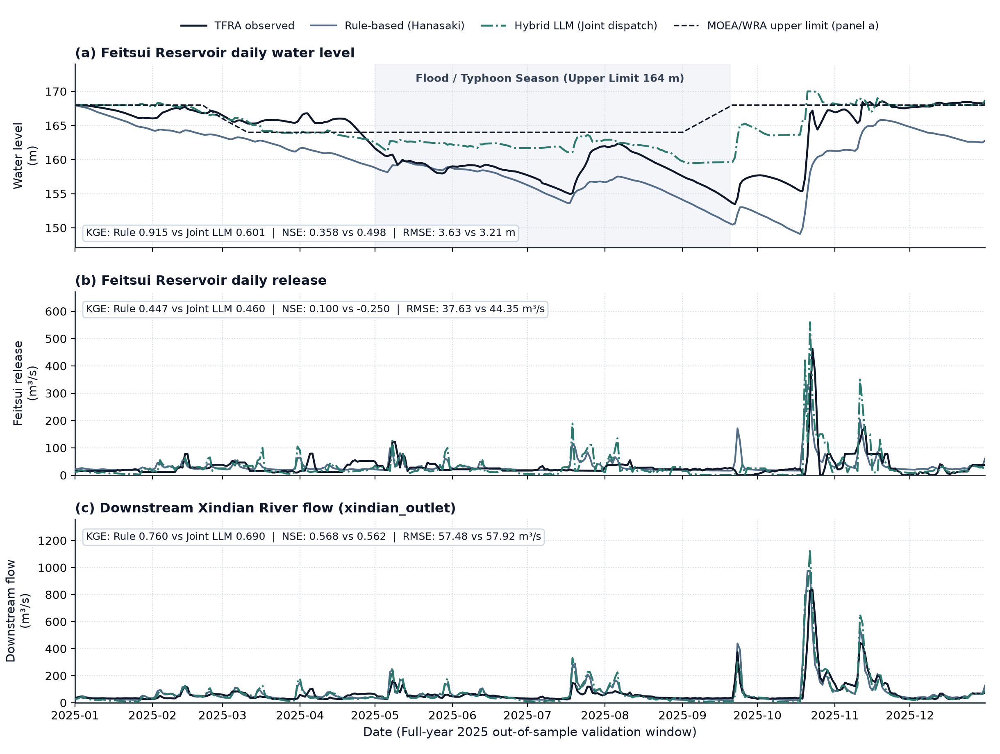

# 多水庫串聯案例：新店溪翡翠水庫 → 直潭壩（Repository 專屬範例）

<div class="hero-band" markdown="1">

本案例為 **GitHub 程式碼庫（Repository）專用的多水庫示範範例**（不收錄於論文文章中，論文主體實驗為單一水庫 F.E. Walter），以台灣新店溪 **2 座水庫串聯系統**（**翡翠水庫 `feitsui`** → **直潭壩 `zhitan`** → **`xindian_outlet`**）於 **10 年（2016–2025）水文率定與驗證（C&V）** 後，針對驗證期末完整 **1 年（2025-01-01 – 2025-12-31，共 365 天）** 進行比較，評估**全規則串聯（Hanasaki + Hanasaki）**與**聯合供水調度混合式 LLM 串聯（翡翠官方規線＋南勢溪側向入流 LLM + 直潭 Hanasaki）**兩種操作條件。

</div>

## 研究區域、10 年 HydroCNHS 水文模型與 C&V

<figure class="figure-card">
  
  <figcaption><strong>圖 5.</strong> 台灣新店溪<strong>雙水庫串聯系統（2 座水庫串聯）</strong>、子集水區（<code>U1–U2</code> 匯入 <code>feitsui_local</code>，30,300 公頃；<code>D1–D2</code> 匯入 <code>zhitan_local</code>，37,680 公頃）、水利署測站（<code>10205</code>、<code>10212</code>）與年均降雨分布（WorldClim 2.1）：<strong>1. 翡翠水庫</strong>（<code>335,505,000 m³</code>，<code>0–500 m³/s</code>）經率定之 Lohmann 單位歷線（<code>[0.801305, 0.198693, 2e-06]</code>）銜接 <strong>2. 直潭壩</strong>（<code>1,918,900 m³</code>，<code>0–800 m³/s</code>），再經 <code>[1.0]</code> 流至 <code>xindian_outlet</code>。</figcaption>
</figure>

本範例的區域增量入流（[`inflows.csv`](inflows.csv)，`data_kind: simulated_local_inflow`）由 4 子集水區 HydroCNHS 模式（[`hydrology/xindian_catchments.yaml`](hydrology/xindian_catchments.yaml)、[`hydrology/hydrology.yaml`](hydrology/hydrology.yaml)）驅動 TFRA `145840` 官方實測集水區日雨量與 ERA5 氣溫／PET（[`hydrology/forcing.csv.gz`](hydrology/forcing.csv.gz)，含 2015 年暖機），並以內建 **`GA_DEAP` + Powell** 對照 **2016–2025 年共 10 年（3,653 天）TFRA 官測紀錄** 完成 7 年率定與 3 年樣本外驗證（[`hydrology/cv_summary.json`](hydrology/cv_summary.json)）：

| 水文階段 | 期間 | 天數 | KGE | NSE | RMSE (m³/s) |
| --- | --- | --- | --- | --- | --- |
| 率定期 Calibration（`U1–U2` 翡翠進流量） | `2016-01-01`–`2022-12-31`（7 年） | 2,557 | `0.926` | `0.863` | `18.73` |
| 驗證期 Validation（`U1–U2` 翡翠進流量） | `2023-01-01`–`2025-12-31`（3 年） | 1,096 | `0.912` | `0.886` | `17.38` |
| 率定期 Calibration（`D1–D2` 南勢溪區間流） | `2016-01-01`–`2022-12-31`（7 年） | 2,557 | `0.839` | `0.711` | `30.53` |
| 驗證期 Validation（`D1–D2` 區間 / 直潭組合流量） | `2023-01-01`–`2025-12-31`（3 年） | 1,096 | `0.844` / `0.916` | `0.684` / `0.831` | `32.86` / `32.30` |

<figure class="figure-card">
  
  <figcaption><strong>圖 6.</strong> HydroCNHS 十年日流量率定（<code>2016–2022</code>）與樣本外驗證（<code>2023–2025</code>，灰底）對照 TFRA 官測紀錄：<strong>(a)</strong> 翡翠水庫進流量（<code>U1–U2</code>）；<strong>(b)</strong> 下游直潭壩組合流量（翡翠演算放流匯入南勢溪 <code>D1–D2</code> 側向入流）。</figcaption>
</figure>

<div class="panel-grid panel-grid-2" markdown="1">
<div class="panel-card" markdown="1">

### 情境一：全規則串聯（Rule-based）

- **設定檔**：[`rule_based.yaml`](rule_based.yaml)
- **方法**：上下游皆採 Hanasaki 滯洪規則（`strategy: benchmark`，α = 0.85），依 7 年率定期（`2016–2022`）官測入流統計 [`feitsui_statistics.json`](feitsui_statistics.json) 與 [`zhitan_statistics.json`](zhitan_statistics.json) 離線執行。
- **期末蓄水量**：翡翠結束於 `271,292,850 m3`（`162.77 m`，由 `316,895,260 m3` 出發）、直潭結束於 `1,918,697 m3`（`PASS`）。

</div>
<div class="panel-card" markdown="1">

### 情境二：混合式 LLM 串聯（聯合供水調度）

- **設定檔**：[`hybrid_llm.yaml`](hybrid_llm.yaml)
- **方法**：上游翡翠水庫（`feitsui_operator`）由 `gemma4:12b` 操作（`strategy: xindian_study`，依經濟部《翡翠水庫運用要點》規線上限 `168 m / 164 m` 並即時接收下游南勢溪側向入流 [`study/formatter.py`](study/formatter.py) 進行直潭聯合供水調度，採統一決策鏈 JSON [`study/response_schemas.json`](study/response_schemas.json) 與 [`study/elevation_storage.csv`](study/elevation_storage.csv)），搭配下游直潭壩（`zhitan_operator`）Hanasaki 規則。
- **提示詞**：[System prompt](prompts/feitsui.system.txt) · [第 1 天 User 範例](prompts/feitsui.user.txt)。
- **期末蓄水量**：翡翠結束於 `321,867,597 m3`（`168.73 m`）、直潭結束於 `1,918,607 m3`（`PASS`）。

</div>
</div>

## 設定檔與快速檢查

兩組條件共用 [`case.json`](case.json) 與 [`inflows.csv`](inflows.csv)（含 `2024-12-30`–`2025-12-31` 共 367 天模擬入流，涵蓋 2025 全年 365 天操作；[`reference_inflows.csv`](reference_inflows.csv) 收錄 `2016–2022` 年共 2,557 天官測流量）。離線檢查並執行全年全規則串聯基準：

```sh
reservoir-experiment check examples/multi_reservoir/rule_based.yaml
reservoir-experiment run examples/multi_reservoir/rule_based.yaml
reservoir-experiment verify runs/multi-reservoir-rule-based --require-offline
reservoir-experiment check examples/multi_reservoir/hybrid_llm.yaml
```

- **編輯入流與 YAML 規則**：修改 `inflows.csv` 後請執行 `python -c "import hashlib,sys; print(hashlib.sha256(open(sys.argv[1],'rb').read()).hexdigest())" examples/multi_reservoir/inflows.csv` 更新 `inflow_source.sha256`；YAML 科學記號務必加上 `+`/`-`（如 `8.0e+6`）。
- **詳細設定指南**：水庫串聯欄位見[多水庫河網串接](../../docs/MULTI_RESERVOIR.zh-TW.md)，提示詞與規則設計見[操作規則與 LLM 設計](../../docs/AGENT_DESIGN.zh-TW.md)，論文單庫基準見[F.E. Walter 水庫案例](../fe_walter/README.zh-TW.md)。

## 2025 全年模擬表現（樣本外驗證年）

<figure class="figure-card">
  
  <figcaption><strong>圖 7.</strong> 2025 全年（365 天）翡翠水庫水位（m）、放流量（m³/s）與新店溪下游流量模擬結果，僅繪製 TFRA 官測紀錄、全規則串聯（Hanasaki + Hanasaki）與聯合調度混合式 LLM 串聯三條序列；(a) 面板同步疊繪經濟部／水利署官方 36 旬運用規線上限（完整上限／中限／下限／嚴重下限收錄於 <a href="study/rule_curve.csv"><code>study/rule_curve.csv</code></a>）。</figcaption>
</figure>

在完整 365 天驗證模擬中，**聯合調度混合式 LLM 串聯**取得比全規則基準更低的水位誤差（水位 `RMSE = 3.21 m`、`NSE = 0.498`，全規則為 `3.63 m` / `0.358`），同時下游總流量 `RMSE` 與全規則幾近相當（`57.92` vs `57.48 m³/s`）；而**全規則 Hanasaki** 則呈現最高的翡翠水位與下游流量相關結構（`KGE = 0.915` / `0.760`，逐項指標見 [`study/expected_scores.csv`](study/expected_scores.csv)）：

| 操作條件 | 翡翠水位 KGE | 翡翠水位 NSE | 翡翠水位 RMSE (m) | 翡翠放流量 KGE / RMSE (m³/s) | 下游流量 KGE / RMSE (m³/s) |
| --- | --- | --- | --- | --- | --- |
| 全規則串聯（Hanasaki + Hanasaki） | `0.915` | `0.358` | `3.63` | `0.447` / `37.63` | `0.760` / `57.48` |
| 混合式 LLM 串聯（聯合調度 LLM + 直潭 Hanasaki） | `0.601` | `0.498` | `3.21` | `0.460` / `44.35` | `0.691` / `57.92` |

## 離線重現或使用本機 Ollama 即時重跑

透過水庫水量平衡引擎與河道演算離線重播 365 天封存放流序列（[`study/archived_releases.csv`](study/archived_releases.csv)），或於本機啟動 `ollama serve`（需已下載 `gemma4:12b`）重新執行即時模擬：

```sh
python examples/multi_reservoir/study/replay.py --output runs/xindian-replay
reservoir-experiment run examples/multi_reservoir/hybrid_llm.yaml --allow-network
```

輸出判讀請見[結果判讀與水量平衡](../../docs/RESULTS_GUIDE.zh-TW.md)。
