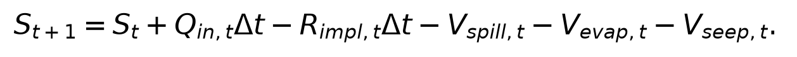
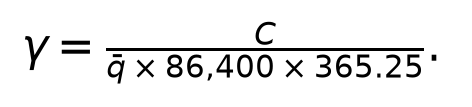
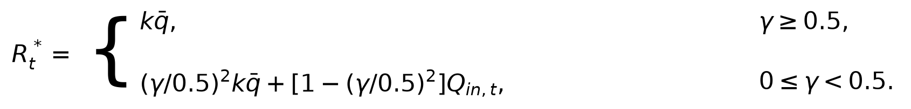
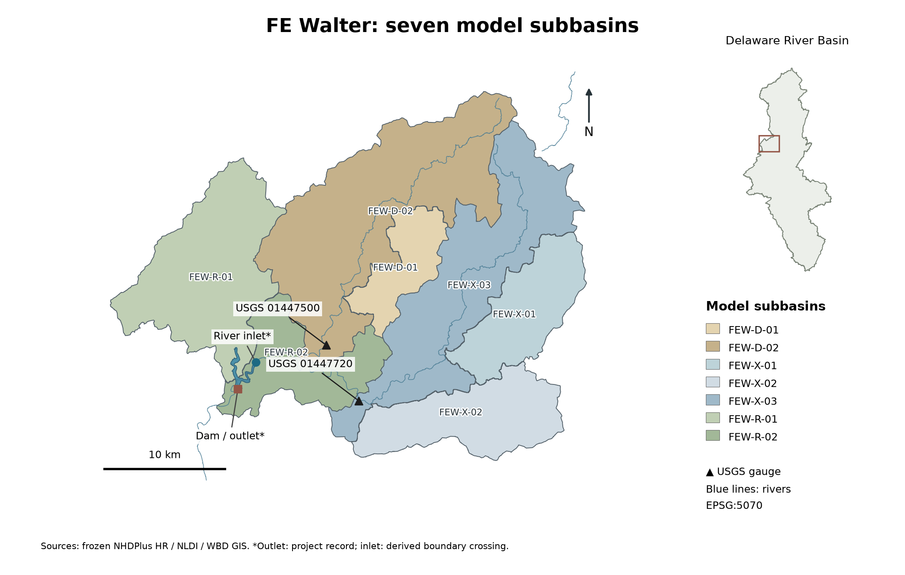

# HydroOpsLM: Configurable Rule-Based and Language-Model Reservoir Decisions in HydroCNHS

**Provisional English draft for a JWRPM Technical Note.** Author names,
affiliations, acknowledgments, venue formatting, and submission length remain to
be confirmed.

## Abstract

Reservoir decisions depend on information that varies with operating purpose,
while hydrological simulation must implement each release under consistent
physical constraints. This technical note presents HydroOpsLM, an extension of
the HydroCNHS Dam application programming interface that separates configurable
decision information, decision methods, response checks, reservoir physics,
river routing, and versioned audit records. Source catalogs and per-agent
information profiles select timestamped observations, completed simulation
values, forecasts, and operating requirements without changing hydrological
equations. A Hanasaki-based daily rule and two language-model examples, using
available information and retrieved operating knowledge, share the same
physical release interface. The extension retains the native HydroCNHS hydrological
models, routing, coupling interfaces, and calibration utilities. Verification
used 162 comparisons with a pinned benchmark function, three-day Francis E.
Walter Reservoir trajectories, and a 31-day three-reservoir network. Six
historical Ollama `gemma3:4b` requests produced the two language-model trajectories.
All six responses were complete and physically executed, but the policy audits
returned two PASS and one FAIL for the available-information example and three
FAIL for the retrieved-knowledge example; no operating
strategy was accepted. Maximum absolute system water-balance residuals were
2.33 × 10⁻¹⁰ m³ for the rule, 0 m³ for the available-information example,
8.73 × 10⁻¹⁰ m³ for the retrieved-knowledge example, and
1.86 × 10⁻⁹ m³ for the synthetic 31-day network. Stored routing outputs matched
independent reconstruction. These results verify the software interface and
accounting path, not the comparative quality or field suitability of the
decision methods.

**Keywords:** HydroCNHS; reservoir operations; large language models; water balance; auditability.

## Introduction

Reservoir operation is a natural-human coupling problem: hydrological states
condition a management decision, and the implemented decision changes storage
and downstream flow. HydroCNHS provides daily hydrological simulation and four
application programming interfaces (APIs)—Dam, RiverDiv, Conveying, and InSitu—
for representing such human actions within model execution (Lin et al. 2022).
The native package includes the GWLF and ABCD rainfall-runoff models, Lohmann
routing, model-building utilities, genetic-algorithm calibration, data
collection, and performance indicators. A reservoir decision extension should
use these capabilities without creating a parallel hydrological model or
allowing a decision generator to bypass physical accounting.

Operating purpose also determines which information is relevant. Irrigation
rules can depend on downstream demand, whereas hydropower rules account for
turbine flow and head (Abeshu et al. 2023). Downstream flood-control constraints
can involve flow or stage at a control point, routing, and local river inflows
(USACE n.d.). A decision interface limited to reservoir inflow would therefore
require case-specific changes when those information needs differ. A reusable
interface needs an explicit selection of information as well as a physical
release contract.

Language models add a specific implementation problem. A model can propose a
numeric release while also returning reasoning, targets, or statements about
the expected storage response. A syntactically valid proposal can still
contradict those statements or exceed the water and outlet constraints of the
reservoir. A reproducible experiment therefore needs separate records for the
proposed action, checks of the response, the physically implemented release,
and its routed consequence. The same separation is useful for a deterministic
rule because it allows alternative decision methods to receive the same
hydrological state and pass through the same physical solver.

This note documents HydroOpsLM, a configurable reservoir decision system integrated through
the HydroCNHS Dam API. Its objectives are to (1) define the responsibility
boundary between decisions and reservoir physics, (2) provide a common interface
for rule-based and language-model methods with configurable information,
(3) show how a researcher
configures and inspects an experiment, and (4) verify numerical compatibility,
water accounting, routing, and trace integrity in saved examples. The evidence
does not establish that a language model is a better reservoir operator, that
an audited response is an approved policy, or that the diagnostic network is a
calibrated representation of downstream travel time.

## System architecture and methods

### Relationship to native HydroCNHS

The extension adds decision configuration and evidence handling around the
existing Dam API (Fig. 1). It does not change the equations or calibrated
parameters used by the native rainfall-runoff models. A source manifest pins the
retained HydroCNHS revision and file hashes. This preservation establishes which
native implementation is present; it is not a new validation of every inherited
module. The added code supplies decision backends, response validation, a common
reservoir solver, routing injection, and linked audit and trace records.

Each controlled reservoir has its own decision unit. YAML configuration selects
one rule or language-model backend, a reservoir profile, physical limits, and an
audit suite. Multiple controlled reservoirs can use the same model profile while
retaining independent histories and causal identifiers. A passive reservoir can
instead use a storage-discharge relation and has no decision agent. The current
multi-reservoir implementation does not provide joint negotiation or a shared
controller among agents.

The daily sequence is explicit. HydroCNHS supplies routed inflow, while the
added reservoir solver supplies beginning-of-step storage. The selected decision
method observes this information and proposes a release. Response checks establish
whether the returned record is parseable and
complete. The common solver then applies availability and outlet constraints,
computes spill and losses, and updates storage. The implemented total outflow is
injected once into downstream routing. The next day's history uses what was
actually executed rather than merely what was proposed.

For daily timestep Δt = 86,400 s, the storage update is

Storage and loss terms are volumes in m³, while inflow and implemented
controlled release are in m³/s. Spill is stored as a volume in this expression
and is also represented as a flow in the execution record. In a connected
network, controlled release plus spill affects downstream inflow after the
specified unit-hydrograph routing. Fixed local catchment inflow remains
unchanged. With meteorological forcing, the native hydrological models generate
runoff and route it to the Dam API during model execution. The saved tutorial
instead supplies frozen reservoir inflow. Already routed inflow must not be
added a second time as local runoff.

### Configurable decision information

The researcher declares an information source catalog and assigns a named
information profile to each configured decision agent. Sources can be constant
values, timestamped CSV observations or forecasts, native simulation quantities,
or providers explicitly registered by the host in Python. A profile selects
fields from that catalog, names them for the prompt, specifies units and retained
history, and declares whether each field is required and how old it may be.
The prompt includes the selected snapshot through an explicit placeholder.
The selection extends the decision input; it cannot replace the host reservoir
state or alter the water ledger.

Each selected value records its quantity, unit, location, source identity,
valid time, and availability time. Forecasts also record their issue time.
Observed values are eligible only when their valid and availability times are
no later than the decision clock. Forecast selection uses the latest available
issue cycle that has unexpired horizons; the earliest eligible horizon supplies
the scalar value, and subsequent horizons form the retained forecast series.
Only the latest available revision at each valid time is retained. Required
missing or stale fields stop execution before a model request; optional missing
fields remain explicit missing records rather than becoming zero.

Native sources preserve the daily simulation's causal order. The acting
reservoir can use its current routed inlet and beginning storage. Other
reservoir releases and downstream routed flows are drawn from completed steps.
The current downstream result is therefore unavailable to the decision that
helps produce it. In the FE Walter demonstrations, current-day inflow is a
prescribed simulation boundary, not evidence that the day's measured mean
would have been available to a real operator. Legacy daily labels are anchored
to UTC for information selection; external records require timezone-aware times.

CSV hashes and parsed samples are retained with the run. Saved-file verification
reconstructs selected CSV, constant, and native values and their histories.
Registered external providers retain a declared version and captured causal
timestamps; verification does not contact them again and does not establish
the accuracy of their supplied values. Reservoir purpose does not silently
choose a profile or impose a policy. Water demand, head, or price can be supplied
as information, but demand allocation and turbine or energy calculations require
separately implemented physical models.

### Common decision and evidence contracts

The portable action contract contains two required fields: a schema version and
`release_cms`. This narrow contract lets the same physical code consume a rule
or model action. The available-information example's native reply contains six
fields, including reasoning and operating targets; the retrieved-knowledge
example adds knowledge-related fields. Both complete
replies remain in the raw trace. The FE Walter prompt requests
release in cubic feet per second, but conversion to cubic meters per second
occurs once at the adapter boundary. Keeping the native reply alongside the
common action preserves evidence without duplicating unit conversion.

Format checks and policy audits answer different questions. Schema and numeric
checks determine whether execution can proceed. An invalid or incomplete reply,
or a transport failure, stops the run before the physical step; the software
does not silently substitute a fallback action. A policy audit can return PASS,
FAIL, WARN, or UNKNOWN after a valid action is parsed. Its verdict is stored and
does not overwrite the requested release. Physical constraints remain the
solver's responsibility. Consequently, a completed run with a negligible water-
balance residual may still contain policy-audit failures and cannot be described
as an accepted operating strategy.

For every reservoir-day, compact logs link the observation, prompt and retrieved
knowledge, native response, common action, audit result, physical transition,
and routing result. Source, prompt, implementation, and rubric hashes identify
the versions used. These hashes establish byte identity and trace binding; they
do not establish empirical validity or policy approval.

Optional control-point checks examine routed flow after the simulation step.
Each check specifies a network node and a minimum or maximum flow, either as a
constant or as a selected information field from a named agent at that decision
time. The diagnostic record contains the resolved limit, routed result, source,
time, and decision references. Unavailable optional limits yield UNKNOWN. These
outcome checks remain separate from the request audit; they neither revise a
release nor assign an individual agent responsibility for a combined river flow.

### Decision methods

The deterministic benchmark is a daily adaptation of the non-irrigation,
flood-control branch described by Hanasaki et al. (2006) and represented in
Abeshu et al. (2023, Eq. 4). It is a reproducible comparison rule rather than an
official FE Walter operating policy. Let C be capacity, q̄ historical mean inflow,
and

At initialization and the start of an operating year, the implementation sets
k = S_start/(αC), with α = 0.85. The provisional daily release is

Requested release is max(R*ₜ, 0.1q̄). The environmental floor belongs to this
benchmark and is not imposed on the language-model methods as a legal site
requirement. Monthly historical means select the first wet-to-dry transition as
the operating-year start, with October as a fallback, matching the pinned daily
reference function. The FE Walter benchmark uses frozen 1996–2015 statistics
and q̄ = 18.25446484681121 m³/s. The 2016 demonstration follows that historical
period, but this division is not presented as a new hydrological calibration and
validation experiment.

The available-information example supplies the original FE
Walter public facts, seasonal target, daily reservoir information, and response
contract. The retrieved-knowledge example adds sections
selected from a sourced operating-knowledge document. Both retain the pinned
FE Walter prompt builder, numerical formatting, response schema, and history
construction; the knowledge example also retains retrieval and audit fields.
The historical source labels, zero-shot and Decision Knowledge Package (DKP),
remain in provenance and file identifiers. They name these demonstration
recipes rather than categories that define the framework.
The reference profiles are site-specific. Applying the approach to another
reservoir requires a new profile, physical relationship, operating knowledge,
prompt package, and versioned audit rules. The native FE DKP adapter rejects a
different reservoir profile because its retrieval and auditor encode FE-specific
content; a generic configured backend accepts independently supplied packages.

## Using the system

A reproducible application begins by identifying the hydrological source of each
reservoir inflow and whether it is local, already routed, or supplied as a frozen
diagnostic series. The researcher then defines reservoir capacity, dead storage,
initial storage, minimum and maximum release, losses, timestep, and downstream
unit hydrographs. Each controlled reservoir receives one decision configuration;
a passive outlet receives its storage-discharge relationship. Site-specific
profiles and operating documents are versioned with the case.

Before a language-model run, the researcher selects a provider and exact model,
sets temperature, token and request limits, and timeout, then
reviews the rendered prompt and units. The saved FE example used Ollama 0.40.3
with `gemma3:4b` digest
`c30276f7dffec93a536d283e15088990454b8d21cf180a3d6eea4959e4147291`,
temperature 0.7, a 2,048-token limit, a 120-s timeout, no seed, and no automatic
retries. These settings describe the historical diagnostic requests; they do
not imply deterministic replication when the seed is unavailable.

Execution produces a directory of decisions, physical transitions, audit
records, backend events, network flows, balances, and raw prompt-response
artifacts. Inspection should proceed in causal order: confirm the observation,
read the native reply and common action, inspect the policy verdict, compare
requested with implemented release and spill, then follow the routed outflow and
next-day history. The independent verifier reconstructs storage and routing from
stored records. Researchers should retain failed audits and invalid attempts
rather than selecting only favorable days. The supplied tutorial applies this
workflow without issuing new model requests when it reads the preserved runs.

## Demonstration and verification

### Francis E. Walter setting

The FE Walter examples demonstrate LLM operation with available information and
LLM operation with retrieved knowledge alongside a rule-based benchmark within
the same single-reservoir workflow.
They document configuration and execution rather than comparative policy performance.

Francis E. Walter Reservoir was selected because the project contains frozen
semidistributed hydrology, operating documents, and a reference decision
program. The study map contains seven geographic model units and USGS gauges
01447500 and 01447720 (Fig. 2). Two D units are parameter donors, three X units are
spatial-transfer diagnostics, and two R units are residual areas. Those roles
describe model construction; they are not calibration or validation proof. The
map is projected in EPSG:5070, so its north arrow denotes grid north. The inlet
is a derived waterbody-boundary crossing and the outlet is taken from the dam
project record; neither is presented as a surveyed point.

The three single-reservoir trajectories use the same daily local inflows for
January 1–3, 2016: 32.12531870666853, 22.353047216043638, and
14.193931416870026 m³/s. Initial storage is 2,457,848.279729185 m³
(1,992.61 acre-ft), retained as a diagnostic assumption. Evaporation and seepage
are zero, and `UH=[1]` provides identity routing. Rainfall-runoff was not
recomputed. These controlled conditions isolate the decision-to-physics path;
they do not represent a complete field operations study.

The benchmark requested 25.098588428722316, 17.49002431902703, and
11.137442353207074 m³/s. The available-information example requested
32.1254629215, 22.3533190218, and 22.3533190218 m³/s. The retrieved-knowledge
example requested 1.41584235 m³/s on
all three days. All nine requests were physically implemented unchanged, spill
was zero, and routing reconstruction differed from stored flow by 0 m³/s. The
rule made no model calls. The two LLM examples together represent six historical
real Ollama calls; every response recorded `done=true` and `done_reason=stop`.

| Example | Decision requests | Policy audit | Maximum absolute system residual (m³) | Final storage (m³) | Historical model calls |
|---|---|---:|---:|---:|---:|
| Hanasaki-based rule, 3 days | 25.0986, 17.4900, 11.1374 m³/s | 3 PASS | 2.3283 × 10⁻¹⁰ | 3,749,203.6091 | 0 |
| LLM with available information, 3 days | 32.1255, 22.3533, 22.3533 m³/s | 2 PASS, 1 FAIL | 0 | 1,752,841.2465 | 3 |
| LLM with retrieved knowledge, 3 days | 1.41584 m³/s each day | 3 FAIL | 8.7311 × 10⁻¹⁰ | 8,024,148.4327 | 3 |
| Three-reservoir network, 31 days | synthetic controlled actions; passive Prompton | 93 UNKNOWN | 1.8626 × 10⁻⁹ | reservoir-specific | 0 |

**Table 1.** Saved diagnostic trajectories and independent verification. The
largest reservoir residual in the 31-day network was 9.3132 × 10⁻¹⁰ m³. Every
row had 0 m³/s routing reconstruction difference and
`operating_strategy_accepted=null`. Audit status concerns configured policy
checks; numerical verification concerns file, physics, and routing consistency.

Numerical compatibility of the benchmark was examined separately from these
trajectories. A frozen 162-vector comparison covered both capacity-ratio branches,
the release floor, initialization, and operating-year behavior; the implemented
daily function matched the pinned Anik reference function in all comparisons.
This evidence supports compatibility with that function, not an official FE
Walter rule or a fresh reproduction of the broader Hanasaki model.

These audit results show why execution and policy assessment must
remain distinct. The final available-information reply contradicted its stated
release relation and storage direction. Retrieved-knowledge replies requested 50 ft³/s
(1.41584 m³/s), but contradicted claimed equal-to-inflow or hold behavior and later
target logic. Both methods returned responses valid enough to execute, and their water
balances were conserved, but the retained audit failures preclude a claim of
accepted policy performance. No new model request was made while preparing this
note.

### Multi-reservoir routing demonstration

The 31-day January 2016 example uses a synthetic decision fixture on an actual
branch topology. FE Walter and Beltzville are independent controlled reservoirs
whose contributions meet on the Lehigh branch. Prompton is a passive outlet on
the West Branch Lackawaxen/Lackawaxen branch. The two branches then meet the
Delaware. The diagnostic outlet sums the three managed-reservoir contributions;
it is not total Delaware River discharge. No universal serial connection among
the three reservoirs is implied, and no agent coordinates their decisions.

The run contains 31 days and 93 reservoir-days. All 93 strategy audits are
UNKNOWN because the synthetic controlled actions and passive outlet have no
applicable operating-policy acceptance result. The maximum absolute reservoir
and system balance residuals are 9.313225746154785 × 10⁻¹⁰ and
1.862645149230957 × 10⁻⁹ m³, respectively; routing reconstruction difference is
0 m³/s. Identity routing verifies connectivity and accounting but does not
validate travel time. Prompton's provisional storage-discharge curve, zero
losses, simplified initial states, and provisional Beltzville bounds further
limit operational interpretation.

### Information-interface verification

Additional synthetic tests exercise decision information without calling a real
model. They cover observed-data availability, forecast issue cycles and expiry,
revision selection, unit conversion, missing and stale fields, and independent
reconstruction of saved selections. A downstream-feedback fixture returns
controlled actions of 5, 2, and 5 m³/s after reading only the previous completed
flow. It demonstrates that a selected downstream field can affect the next
decision, not that this fixture is a useful operating policy. A 31-day
three-reservoir fixture verifies profile isolation and unchanged water accounting.
Separate outcome records preserve FAIL or UNKNOWN even when the request audit
has a different verdict. These tests examine data and coupling contracts; they
do not validate flood protection, water-supply delivery, or energy generation.

## Implications and limitations

The main contribution is an inspectable boundary between decision generation
and hydrological execution, together with an explicit selection of what each
decision method can observe. A researcher can compare decision methods while
holding the physical solver and routed inflow constant, or can replace physical
and policy packages without changing the common action interface. Persistent
causal records make it possible to identify whether a discrepancy originated in
the prompt, parser, policy audit, physical constraint, or routing step. These
properties support controlled software experiments and later reproducibility
review.

The current evidence remains diagnostic. Three days and one unseeded model
instance do not characterize stochastic response distributions or compare
decision quality. Policy-audit failures are observations from the saved replies,
not estimates of a general failure rate. Fixed inflows omit feedback to catchment
runoff generation. Identity unit hydrographs do not establish downstream timing,
and the multi-reservoir outlet excludes unmanaged flow and lateral inflows. The
FE initial storage, seasonal target, prompt and physical capacities, DKP schedule
applicability, and environmental-flow exceptions require case-specific review.
Each additional reservoir needs sourced physical relationships, operational
knowledge, prompts, and audit rules. Human review of the operating meaning and
an independently designed experiment are required before policy-performance or
live-operation claims are considered.

## Conclusions

HydroOpsLM integrates rule-based and language-model reservoir
decisions through the native HydroCNHS Dam API while keeping proposal, policy
checks, physical implementation, routing, and evidence records distinct. The
162-vector benchmark comparison and saved single- and multi-reservoir
trajectories support the implemented interface and numerical accounting. Six
historical language-model responses also show that physical completion
does not imply policy acceptance: four of six daily audits failed and no
strategy was accepted. The system is therefore ready for inspectable research
workflows and tutorial use under documented assumptions, while comparative
operating performance remains an open experimental question. The information
contract enables different source selections within this daily runner, while
each new operating purpose still requires sourced criteria and an appropriate
physical representation.

## Data and software availability

Code, source manifests, case settings, prompts, frozen input references, editable
figures, tutorial sources, and saved result records are maintained in
[HydroOpsLM](https://github.com/WenyuChiou/HydroOpsLM). The
repository is currently private, and a public archive with a persistent DOI has
not yet been designated. The tutorial describes how to reconstruct reported
results from the saved actions without making a model request.

For authors who opt into ASCE's Reproducible Results program, the 2025 policy
requires public data, model, code, and directions; one-action reconstruction; a
DOI archive; and project-independent colleague reproduction (Stagge et al. 2025). Public
release, DOI, and named human reproduction remain open. Any Data Availability
and Reproducible Results statements must report the released artifacts, reviewer
name, affiliation, and outcome. The present AI-assisted review is not that
certification.

## References

Abeshu, G. W., F. Tian, T. Wild, M. Zhao, S. Turner, A. F. M. K. Chowdhury,
C. R. Vernon, H. Hu, Y. Zhuang, M. Hejazi, and H.-Y. Li. 2023. “Enhancing the
representation of water management in global hydrological models.”
*Geoscientific Model Development*, 16, 5449–5472.
[doi:10.5194/gmd-16-5449-2023](https://doi.org/10.5194/gmd-16-5449-2023).

Hanasaki, N., S. Kanae, and T. Oki. 2006. “A reservoir operation scheme for
global river routing models.” *Journal of Hydrology*, 327(1–2), 22–41.
[doi:10.1016/j.jhydrol.2005.11.011](https://doi.org/10.1016/j.jhydrol.2005.11.011).

Lin, C.-Y., Y.-C. E. Yang, and S. Wi. 2022. “HydroCNHS: A Python package of
hydrological model for coupled natural–human systems.” *Journal of Water
Resources Planning and Management*, 148(12), 06022005.
[doi:10.1061/(ASCE)WR.1943-5452.0001630](https://doi.org/10.1061/%28ASCE%29WR.1943-5452.0001630).

Stagge, J. H., D. E. Rosenberg, A. M. Castronova, A. Ostfeld, and
A. Spackman Jones. 2025. “Update to the Journal of Water Resources Planning
and Management’s Reproducible Results Policy.”
*Journal of Water Resources Planning and Management*, 151(1),
01824002; published online October 29, 2024.
[doi:10.1061/JWRMD5.WRENG-6726](https://ascelibrary.com/doi/10.1061/JWRMD5.WRENG-6726).

USACE (U.S. Army Corps of Engineers). n.d. “The Downstream Control Function Rule.”
*HEC-ResSim 3.5 User's Manual*. Accessed October 14, 2026.
[Official documentation](https://www.hec.usace.army.mil/confluence/ResSimDocs/rsum/reservoir-operations/reservoir-operations-the-rules/the-downstream-control-function-rule).

## Figures

**Figure 1.** HydroOpsLM couples a selected reservoir operation method to the
native HydroCNHS water pathway. Blue arrows carry water; black arrows carry
information, release proposals, and records. Available information is a
configured selection from simulation and external data; optional knowledge
adds prompt content. Downstream simulation feedback uses completed days. Orange
identifies operating rules, purple identifies LLM decision modules, teal identifies
checks and records, and gray identifies external or optional information.
The native Dam API is retained; HydroOpsLM adds common storage, release, and
spill calculations at the reservoir node. Each reservoir uses one method;
the diagram does not prescribe a serial arrangement of multiple reservoirs.

**Figure 2.** Hydrological setting of the FE Walter single-reservoir example:
seven model units, mapped rivers, and USGS gauges
01447500 and 01447720 in the Delaware River Basin. D denotes parameter donors, X
spatial-transfer diagnostics, and R residual units; these roles are not
calibration or validation evidence. Geometry is retained from the project's
frozen NHDPlus HR, NLDI, and WBD sources in EPSG:5070, for which the arrow shows
grid north. The outlet follows the dam project record, and the inlet is a
derived waterbody-boundary crossing rather than a surveyed location.
