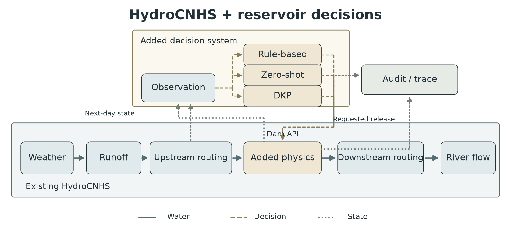

# A Configurable Reservoir Decision System for HydroCNHS: Rule-Based and Language-Model Interfaces

**Initial English draft for a JWRPM Technical Note — software verification scope.**
Author names, affiliations, acknowledgments and submission formatting remain to be confirmed.

## Abstract

HydroCNHS couples daily hydrological simulation with human decisions through four
application programming interfaces. Reservoir decisions supplied by language
models require an additional distinction between a proposed release and the
release that can be physically implemented. This technical note presents an
extension of the HydroCNHS Dam interface that separates configurable decision
backends, reservoir physics, river routing and versioned audits. Three methods
share the same observation and action contracts: a Hanasaki-based flood-control
benchmark, zero-shot prompting, and prompting with a Decision Knowledge Package
(DKP). Francis E. Walter Reservoir provides the single-reservoir example, with
preserved simulated inflow and original-compatible prompts. Offline verification
included 162 numerical comparisons of the benchmark function, three-day examples
of each method, and a 31-day network with two controlled reservoirs and a passive
outlet. The network's maximum absolute daily system water-balance residual was
3.73 × 10⁻⁹ m³, and stored routing outputs matched their independent reconstruction.
The language-model examples used synthetic replies and therefore establish
interface behavior rather than operating-policy performance. The extension
provides inspectable configuration, decision-to-physics records and tutorial
notebooks while retaining the native HydroCNHS core and calibration tools.

**Keywords:** HydroCNHS; reservoir operations; language models; water balance; auditability.

## Introduction

Reservoir operation introduces human decisions into the hydrological cycle.
HydroCNHS already represents such decisions through Dam, RiverDiv, Conveying and
InSitu interfaces that place human actions within the model's routing sequence
(Lin et al. 2022). The present work builds on that architecture. It retains the
hydrological core and adds a configurable reservoir decision system at the Dam
interface, rather than introducing a second hydrological model.

A language model can propose a release from a description of inflow, storage and
operating knowledge. That proposal must be distinguished from a physical state
update: a requested release may exceed available water or outlet capacity.
Separating these responsibilities also makes a comparison with deterministic
rules interpretable. Each method can receive the same inflow and initial state,
while the same physical and routing code converts its requested release into
implemented outflow. The objective of this note is to document and verify that
interface, its configuration and its evidence trail. It does not test whether a
language model operates a reservoir better than a rule-based benchmark.

## HydroCNHS and the extension

The bundled HydroCNHS source retains GWLF and ABCD rainfall–runoff models, Hamon
potential evapotranspiration, Lohmann routing, the four coupling interfaces,
model-building utilities, genetic-algorithm calibration, data collection,
performance indicators and sediment-related tools. These are inherited
capabilities, not contributions of this extension. A source manifest pins the
upstream revision and individual file hashes. Availability of the full source
does not imply new empirical validation of every module.

The added system has four responsibilities (Fig. 1). A reservoir-local decision
backend receives an observation and returns requested release. A common physical
solver applies water availability and outlet constraints, calculates spill and
updates storage. HydroCNHS routes the implemented total outflow through the river
network. Audit and trace code bind the observation, proposal, physical transition
and diagnostic findings to the same reservoir and day. YAML assigns one decision
unit to each controlled reservoir; passive outlets use their rating relationships
without a language-model agent. Agent history and audit state remain separate
between reservoirs even when they share a model profile.

The daily observation precedes the decision and contains the date, timestep,
routed inflow, starting storage and available physical context. The solver then
computes the end-of-day balance,

\[
S_{t+1}=S_t+Q_{in,t}\Delta t-R_{impl,t}\Delta t-V_{spill,t}-V_{evap,t}-V_{seep,t},
\]

where storage and loss volumes are in m³, flows are in m³/s, and Δt is 86,400 s.
Implemented controlled release and spill are injected once into downstream
routing. The next day's history retains the proposal and the actual total
outflow. Reservoir decisions therefore change storage and downstream inflow in
connected networks. They do not alter rainfall–runoff equations or calibrated
hydrological parameters. With fixed upstream inflow and one reservoir, this
feedback concerns reservoir operations; it does not constitute feedback to
catchment runoff generation.

The operations runner consumes supplied daily local inflows. A researcher who
starts with meteorological forcing first uses the native HydroCNHS model setup
and then connects its routed reservoir inflow through the same Dam interface.
Already routed reservoir inflow must not be introduced again as additional local
runoff. A serial network adds upstream implemented outflow, local inflow and
travel delay at each downstream reservoir. Tributary networks instead combine
the routed contributions at their confluence.

## Three decision methods

### Hanasaki-based daily benchmark

The benchmark is a daily adaptation of the non-irrigation, flood-control branch
associated with Hanasaki et al. (2006). The formulation is also documented by
Abeshu et al. (2023, Eq. 4). It serves as a reproducible decision baseline, not as
an official Francis E. Walter operating policy or a reservoir controller built
into the original HydroCNHS release.

Let C be reservoir capacity, q̄ the historical mean inflow, and
γ = C/(q̄ × 86,400 × 365.25) the ratio of capacity to annual inflow volume.
At initialization and at the start of an operating year, define
k = S_start/(αC), with α = 0.85. The daily provisional release is

\[
R^*_t=\begin{cases}
k\bar q,&\gamma\geq0.5,\\
(\gamma/0.5)^2k\bar q+[1-(\gamma/0.5)^2]Q_{in,t},&0\leq\gamma<0.5.
\end{cases}
\]

Requested release is max(R*ₜ, 0.1q̄). The 10% floor belongs to this benchmark;
it is not transferred to the language-model policies as a site-specific legal
requirement. The common solver still determines feasible release. Monthly
historical means select the first wet-to-dry transition as the operating-year
start, with an October fallback when no such transition exists, matching the
pinned reference implementation. For FE Walter the selected month is May.

The FE statistics use 7,305 days from 1996–2015 in the frozen simulated-inflow
record. Mean inflow is 18.25446484681121 m³/s using the reference conversion
factor. This period precedes the 2016 demonstration and is a benchmark climatology,
not a new calibration/validation split. Only the release decision was integrated;
the reference program's separate simulation driver and physical model were not
copied into the operations loop.

### Zero-shot and DKP

Zero-shot supplies the original FE Walter public facts, seasonal target, daily
state and response contract without DKP retrieval. The DKP method adds selected
sections of a Decision Knowledge Package, a document that records operating
knowledge and its sources. The retained native builder chooses sections
conditionally rather than inserting the entire document. Both methods preserve
the reference system text, numerical formatting, state builder and response
schema; the DKP method also preserves retrieval and the original policy audit.
The system prompts are external files, and the daily variables are separately
exposed in trace. Exact FE compatibility is distinct from an intentionally
modified prompt, which requires an explicit custom setting and a new source hash.

The reference profiles and auditors contain reservoir-specific facts. A new
reservoir must supply its own profile, level–storage relationship, operating
knowledge and versioned checks. The native FE DKP path rejects other reservoir
profiles because its retrieval and auditor contain FE-specific rules. The generic
configured backend accepts independent prompt/knowledge packages and auditors
for other cases. Separate live templates retain temperature 0.7, explicit model
identifiers, output limits, timeout and request caps. No provider was invoked for
the demonstrations reported here.

## FE Walter demonstration and verification

Francis E. Walter Reservoir was selected because the project already had frozen
semidistributed hydrology, operating documents and a reference decision program.
The study map uses the earlier Demo's formal GIS layers (Fig. 2). Seven geographic
model units comprise two donor, three spatial-transfer diagnostic and two residual
units; a dummy aggregation node in model YAML has no separate mapped footprint.
The retained hydrological calibration and validation periods are 1990–2010 and
2011–2020. Those parameters and simulated inflows were not recalibrated or rerun
for this software demonstration.

The three single-reservoir examples use the same physical case and frozen inflow
for January 1–3, 2016. The reference initial storage is 1,992.61 acre-ft, retained
as an assumption rather than relabeled as an observed starting condition. The
network example covers January 2016 with FE Walter and Beltzville as separate
controlled reservoirs and Prompton as a passive outlet. FE Walter and Beltzville
contribute through the Lehigh system; Prompton contributes through the Lackawaxen
system. The reported managed outlet sums these reservoir contributions, not the
entire Delaware River discharge. Identity unit hydrographs test connectivity and
water accounting; separate regression tests exercise delayed routing, channel
storage, serial reservoirs and confluence.

Verification addressed numerical compatibility, physical conservation and
evidence consistency. The benchmark release function matched the pinned reference
function in all 162 differential cases, including both capacity-ratio branches
and the environmental floor. Backend tests also covered initialization, operating-year
changes, chronology and invalid statistics. Prompt/profile tests covered
original FE rendering and cross-reservoir isolation. Independent saved-output
verification reconstructed storage transitions and routed volumes, checked
decision/audit bindings and required zero model calls for offline acceptance.

| Example | Duration | Maximum absolute reservoir residual (m³) | Maximum absolute system residual (m³) | Routing reconstruction difference (m³/s) | Model calls |
|---|---:|---:|---:|---:|---:|
| Rule benchmark | 3 days | 2.33 × 10⁻¹⁰ | 2.33 × 10⁻¹⁰ | 0 | 0 |
| Zero-shot, synthetic replies | 3 days | 0 | 0 | 0 | 0 |
| DKP, synthetic replies | 3 days | 0 | 0 | 0 | 0 |
| Two controlled reservoirs + passive Prompton | 31 days / 93 reservoir-days | 3.03 × 10⁻⁹ | 3.73 × 10⁻⁹ | 0 | 0 |

**Table 1.** Absolute daily residuals from independent verification of stored
offline runs. Routing difference compares reconstructed and stored outputs.
The language-model rows contain synthetic replies and are not performance trials.

All four runs passed file, physical and routing verification. Each single-reservoir
run retained three configured audit PASS records. The network retained
62 PASS records for controlled decisions and 31 UNKNOWN records for passive
Prompton, whose operating strategy was not evaluated by those decision auditors.
Operating-strategy acceptance remained unset. These results establish that
decisions can pass through a common physical/routing implementation with a
consistent trace. They do not rank the three policies; equal fixture trajectories
do not establish equal language-model behavior.

## Auditability, reuse and limits

Audits record the selected rubric, implementation version, source hashes and
decision binding. PASS means the configured checks passed; FAIL, WARN and UNKNOWN
retain their diagnostic meanings. Audit does not silently replace a requested
action, while physical limits are applied by the solver. Invalid, incomplete or
transport-failed model replies stop before release is applied. Compact daily logs
link to full prompt, retrieval, schema and audit evidence in raw records.
An independent verifier checks continuity and conservation from stored files;
hashes establish byte consistency, not empirical policy validity.

Fixed upstream forcing limits the present demonstrations to operation and routing
feedback. Identity routing does not establish downstream travel-time accuracy.
The assumed initial storage, simplified seasonal target, differing physical and
prompt capacities, DKP schedule applicability and environmental-flow exceptions
remain explicit conditions for a real FE Walter experiment. Each additional
reservoir requires its own sourced physical and policy settings. The existing
five-year diagnostic trajectory, including policy audit failures and failed or
unknown requests, is preserved and is not promoted to an accepted operating
strategy by the current software checks.

## Conclusions

The extension places rule-based and language-model reservoir decisions within
the existing HydroCNHS Dam interface while retaining separate responsibilities
for physics, routing and audit. Numerical benchmark comparisons and offline
single- and multi-reservoir tests support the implemented interface and water
accounting. Researchers can use the YAML examples and executed notebooks to
inspect inputs, prompts, knowledge retrieval and resulting transitions before
configuring their own reservoirs. Assessing policy performance requires a
separate, explicitly designed real-model experiment with verified initial
conditions, routing, operating rules and stochastic replication.

## Data and software availability

Code, source manifests, three-method settings, prompts, frozen input references,
editable figures, notebook sources and offline acceptance records are maintained
in [LLM_reservoir_agent](https://github.com/WenyuChiou/LLM_reservoir_agent).
The repository is currently private; public release and a permanent archival DOI
remain author decisions before submission. Native HydroCNHS source and its current
license attribution are retained. Full settings and prompt text are provided in
the [tutorial](../tutorials/README.md) and [settings guide](../docs/USER_GUIDE.md),
with the [offline evidence](../results/technical_note_offline/README.md).

## References

Lin, C.-Y., Y.-C. E. Yang, and S. Wi. 2022. “HydroCNHS: A Python package of
hydrological model for coupled natural–human systems.” *Journal of Water Resources
Planning and Management*, 148(12), 06022005.
[doi:10.1061/(ASCE)WR.1943-5452.0001630](https://doi.org/10.1061/%28ASCE%29WR.1943-5452.0001630).

Hanasaki, N., S. Kanae, and T. Oki. 2006. “A reservoir operation scheme for global
river routing models.” *Journal of Hydrology*, 327(1–2), 22–41.
[doi:10.1016/j.jhydrol.2005.11.011](https://doi.org/10.1016/j.jhydrol.2005.11.011).

Abeshu, G. W., F. Tian, T. Wild, M. Zhao, S. Turner, A. F. M. K. Chowdhury,
C. R. Vernon, H. Hu, Y. Zhuang, M. Hejazi, and H.-Y. Li. 2023.
“Enhancing the representation of water management in
global hydrological models.” *Geoscientific Model Development*, 16, 5449–5472.
[doi:10.5194/gmd-16-5449-2023](https://gmd.copernicus.org/articles/16/5449/2023/).

## Figures

**Figure 1.** Existing HydroCNHS hydrology/routing and the added reservoir decision
system. Solid blue arrows carry water, dashed brown arrows carry requested
release, and dotted green arrows carry state/evidence. Rule-based, zero-shot and
DKP (Decision Knowledge Package) are alternative backends. Added reservoir
physics operates at the original Dam API and returns implemented outflow;
next-day state feeds the next observation. Audit retains decision and transition
records rather than acting as a replacement controller.

**Figure 2.** Seven FE Walter model subbasins, mapped rivers and USGS stations in
the Delaware River Basin. Geometry is retained from the project's frozen
NHDPlus HR/NLDI/WBD GIS in EPSG:5070. The dam/outlet point comes from the project
record; the inlet is a derived river/lake boundary crossing, not a surveyed
location. Exact source revisions and hashes are supplied with the editable map.
