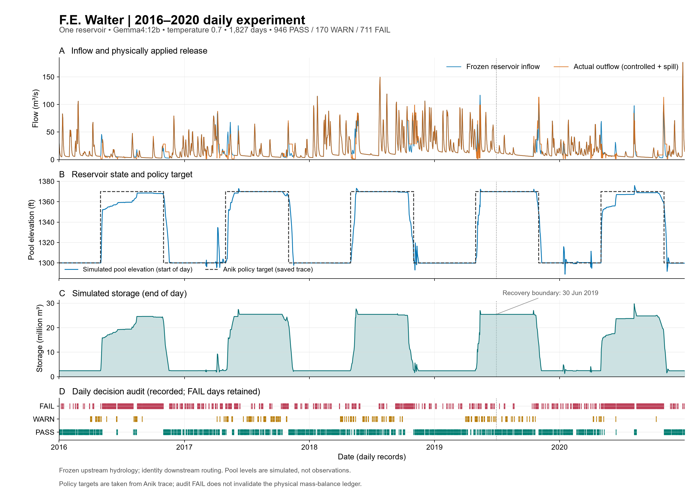
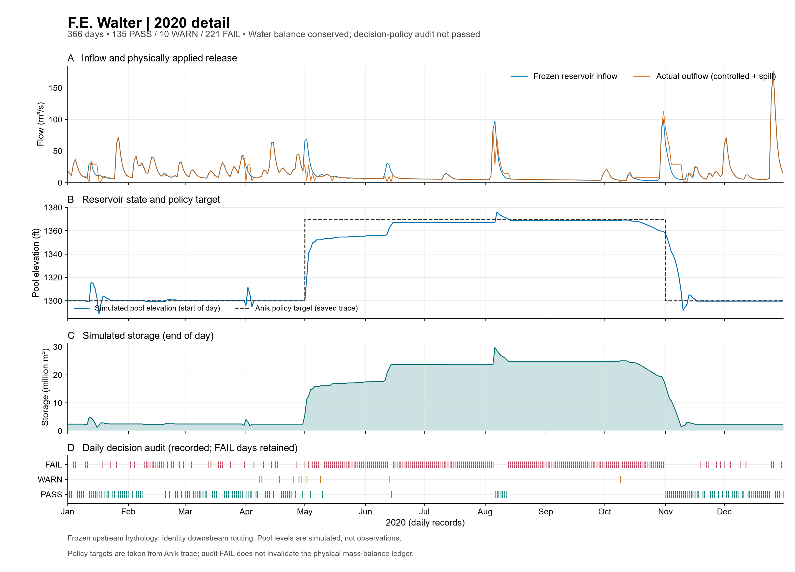
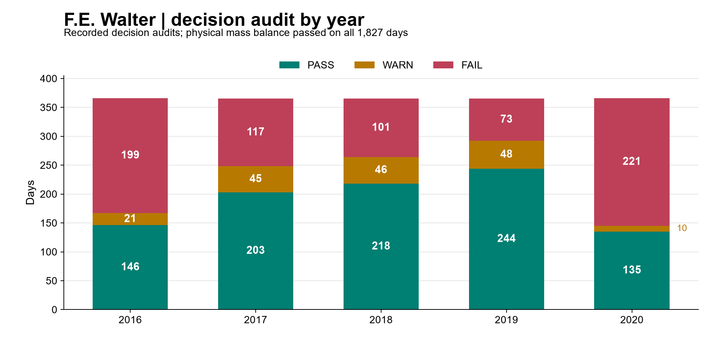

# FE Walter：2016–2020 daily

**1,827 天已完成，temperature 0.7。** 原 1,276 天保留，僅續跑 2019-06-30–2020-12-31 的 551 天。每日蓄水因果連續與水量平衡殘差皆為 0 m³，hard physics failures 0；操作策略仍為 **FAIL**。

| 項目 | 結果 |
|---|---:|
| Audit | 946 PASS／170 WARN／711 FAIL |
| Policy failures | 705 天 |
| Spill | 0 天 |
| 最終蓄水量 | 2,426,260.491603742 m³ |
| 請求 | 1,841 started＝1,827 returned＋13 failed＋1 unknown |

採用凍結的七區 semi-distributed GWLF／Lohmann 入流。LLM 請求放流，物理程式更新蓄水並提供 controlled release＋spill 給 HydroCNHS。下游 identity unit hydrograph 是介面測試；原生 routing 的結束後檢查僅完成 551 天 suffix，原 1,276 天沒有保存 outlet arrays。不能宣稱全五年原生 routing 已独立驗證。

初始蓄水 1992.61 acre-feet 是原版假設，非觀測；水庫降水、蒸發、滲漏、取水均為 0。水位 target 沿用原 policy，未改成新操作規則。原 12 次 failed attempts 與新增一次 JSON 截斷失敗保留；attempt1289 結果與費用仍未知。backend seed 未指定，重新生成不能保證相同決策。

[每日結果](trajectory.csv) · [繪圖資料與逐日 audit](figures/plotted_daily.csv) · [驗收](acceptance.json) · [摘要](summary.json) · [原始實驗設定](experiment.json)。`figures/` 同時提供 PDF 與 SVG；圖表由已保存紀錄產生。完整 provider 回覆與稽核原文保留在原本本機 run，來源雜湊列在 [manifest](../manifest.json)。
