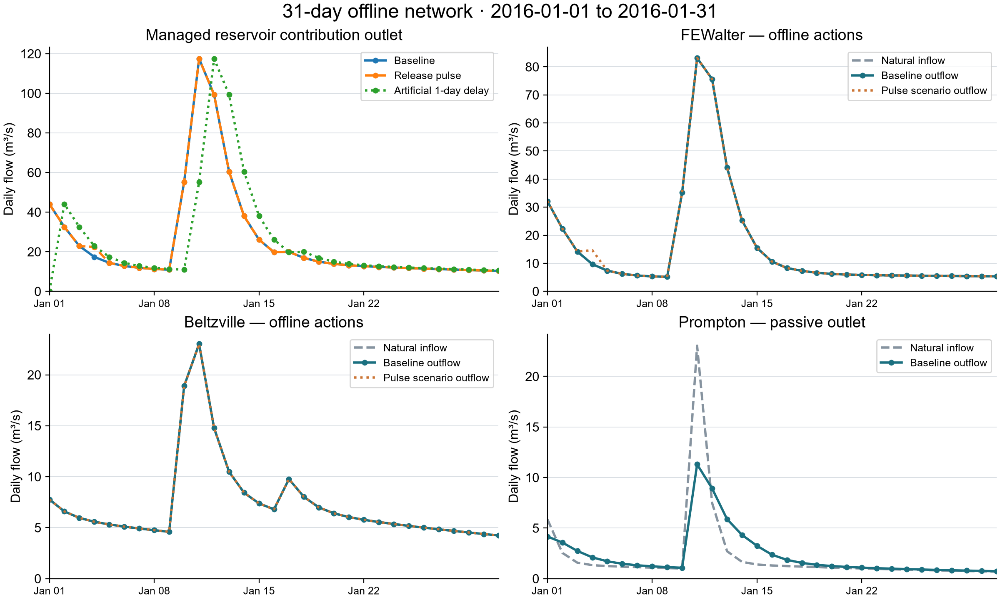
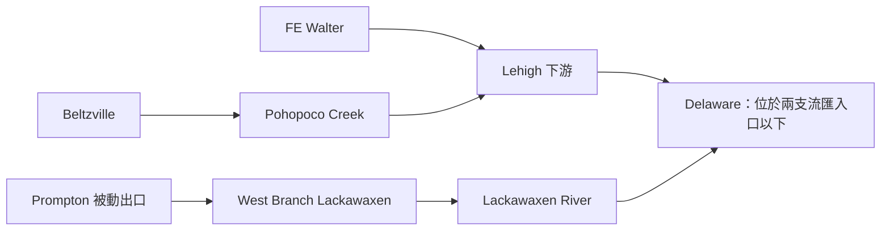

# 三庫一個月 daily 離線測試

2016-01-01～01-31，共31天。FE Walter、Beltzville 使用給定放流；Prompton 使用被動出口。真實 LLM 呼叫0次。

| 驗收／干預 | 實際結果 |
|---|---|
| Baseline／FE pulse／Belt pulse／人工一日延遲 | 四情境各31天、93 reservoir-days，共372 reservoir-days |
| 水庫與河道水量平衡 | 最大獨立重算 system residual5.471520125865936e-9 m³；reservoir residual9.313225746154785e-10 m³ |
| Routing | Native／獨立卷積差0 m³/s；controlled release＋spill只注入一次 |
| FE 1/4放流＋5 m³/s | 當日出口＋5 m³/s；期末FE蓄水減432000 m³；其他兩庫不變 |
| Belt 1/15放流＋2 m³/s | 當日出口＋2 m³/s；期末Belt蓄水減172800 m³；其他兩庫不變 |
| 人工延遲 | 出口序列延後一日；期末在途水量891255.2611773526 m³；各庫結果不變 |
| Audit／trace | 每情境93 decision／physics／audit，279 backend events；raw hashes／因果IDs／日期／庫容連續均驗證 |
| 策略audit | 每情境93 UNKNOWN；未提供operating auditor，未判策略通過 |
| 前7天一致性 | Baseline／FE pulse／delay的原21筆transitions完全一致；舊檔未改寫 |

Baseline給定放流等於入流，所以FE／Belt蓄水幾乎固定；這是介面與守恆測試，不是LLM營運策略。Prompton出流由Q(S1)與水量平衡共同決定：整月入流最大23.03822837130138 m³/s，出流最大11.303184193913811 m³/s，庫容4.447～5.497百萬m³，未跨出已知rating範圍。本次各情境沒有capacity spill／physical clipping；其一般失敗與spill覆蓋保留先前94-test證據。

## 誰影響誰

放流改變本庫後續蓄水及沿箭頭的下游流量。三庫之間沒有A庫放流直接成為B庫入流的串聯關係；此次pulse實際核對其他兩庫入流與完整transition均未改變。Frozen自然產流不由agent改變。共同下游目標可成為未來joint LLM協調的依據，這次只測物理連接。通用模型的真正串聯案例則會將上游總放流route成下一庫Qin，先前cascade regression已有覆蓋。

河川位置依USACE來源：[FE Walter](https://www.nap.usace.army.mil/Missions/Civil-Works/Francis-E-Walter-Dam/)、[Beltzville](https://www.nap.usace.army.mil/Missions/Civil-Works/Beltzville-Dam/)、[Prompton](https://www.nap.usace.army.mil/Missions/Civil-Works/Prompton-Jadwin-Dam/index.html)。此次使用agency search-index片段與既有本機來源；full-page fetch403的證據保留於[來源紀錄](geographic_evidence.json)，沒有下載科學資產或推估旅行時間。

模擬將各支流壓縮成managed contribution junction；實際河網方向如上，出口只代表三庫流量貢獻，不是完整Delaware河川流量。零延遲／人工一日UH未校正，Prompton出口曲線仍為圖面近似、初始S0為UTC日均proxy、Belt物理界線仍是數值測試設定，損失項為零。**live_readiness=false**，策略仍未驗收。

完整資料：[baseline](baseline/reservoir_trajectory.csv)、[FE pulse](fe_pulse/reservoir_trajectory.csv)、[Belt pulse](belt_pulse/reservoir_trajectory.csv)、[delay水量帳本](delayed/network_balance.csv)、[驗收JSON](acceptance.json)、[檔案manifest](manifest.json)。[月case與重現方法](../../cases/fe_belt_prompton_offline/README_2016_01.md)共用既有曲線與物理設定。已有94-test執行依相同package／tests／core依賴bytes沿用，並未重新跑整套；本次4個月run與逐檔驗證均為新執行。

圖另有[PDF](figures/overview.pdf)與[SVG](figures/overview.svg)。[原7天驗收](../three_reservoir_offline/RESULTS.md)及原FE五年711 audit FAIL／13failed／attempt1289未知與未知費用均保留。[真實LLM前置測試計畫](../../docs/offline_pre_live_acceptance.md)仍適用。
