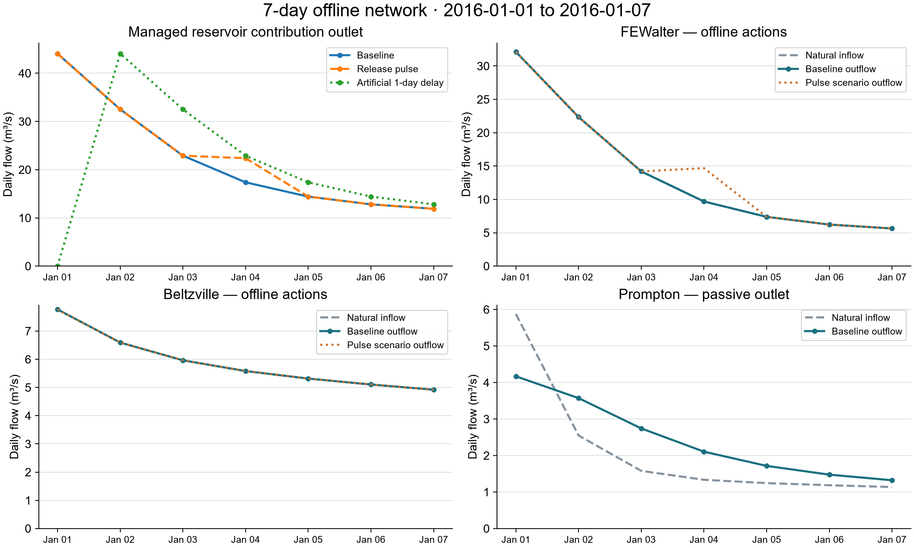

# 三庫 7 天離線聯合測試

2016-01-01–01-07；FE Walter、Beltzville 使用給定合成放流，Prompton 使用被動出口。真實 LLM 呼叫 **0**。

| 驗收 | 結果 |
|---|---|
| Baseline／FE pulse／人工一日延遲 | 各 7 天、21 reservoir-days；日期與蓄水連續 |
| 全系統水量誤差 | 獨立驗收最大 1.6298145055770874 × 10⁻⁹ m³，含 reservoir 和 channel storage |
| Native routing／獨立卷積 | 一致；release + spill 只注入一次 |
| FE 2016-01-04 放流 +5 m³/s | 出口 +5.0000000000000036 m³/s；FE 蓄水少 432,000 m³ |
| 另外兩庫 | 天然入流與整段實施結果不變；此地理案例為支流匯合，非三庫串聯 |
| 延遲案例期末在途水量 | 約 1,026,967.96 m³；納入水量帳本 |
| Audit／trace | 每案例 21 decisions／physics／audit、63 backend events；raw payload 雜湊與因果 IDs 均驗證 |
| 策略 audit | 每案例 21 UNKNOWN；沒有操作 auditor，不判定策略通過 |
| 回歸測試 | 94 tests、0 failures／errors／skips；網路連線被禁止 |

出口為三库貢獻總和，非完整河川流量。零延遲 baseline 和人工延遲都不是已校正河段。Prompton 出口為 WCM 圖面近似取點，僅在 1125–1200 ft NGVD29 計算；超界停止。初始蓄水是日均觀測 proxy，Beltzville 界線是離線數值設定。**真實 LLM 前置條件尚未全部具備。**

原 FE 五年 711 audit FAIL 與失敗／未知費用紀錄保留。此次曾有 Windows Temp 的 progress.json 替換錯誤；原因未證實，改用保留的專案測試輸出目錄後 targeted test 與全套 89 tests 通過，原程式未加入盲目重試。前次失敗 log 一併保存。

資料：[baseline](baseline/reservoir_trajectory.csv)、[FE pulse](fe_pulse/reservoir_trajectory.csv)、[delay 帳本](delayed/network_balance.csv)、[發布驗收 JSON](acceptance.release.json)、[檔案 manifest](manifest.json)。重現 case 與各種區域／庫數／prompt／DKP 的測試規劃見 [前置驗收計畫](../../docs/offline_pre_live_acceptance.md)。圖另提供 [PDF](figures/overview.pdf) 與 [SVG](figures/overview.svg)。

獨立審查發現的 audit 狀態提升與不合理 release/spill 分拆缺口已修正；新增更新雜湊後仍須拒絕的毀損測試。原始 89-test 與初次驗收紀錄保留；發布前 94-test 與三個既有 run 的檔案驗證通過，沒有重跑實驗。92-test 驗收仍保留；額外補上 observation／action schema、設定的物理限制及放流上限核對。
