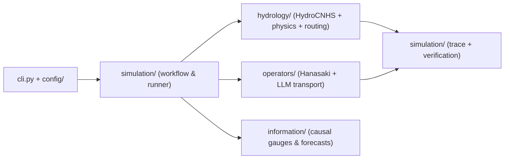

# `llm_reservoir_agent` Source Map

`llm_reservoir_agent` is organized into five domain subpackages mirroring the closed-loop simulation pipeline:

| Path | Role | Key Modules |
| --- | --- | --- |
| `cli.py` | `reservoir-experiment` CLI entrypoint | `main` (`check`, `prepare`, `run`, `verify`, `resume`, `init-examples`) |
| `config/` | Load, validate, and resolve YAML/JSON configs | `loader.py`, `agent_config.py`, `case.py`, `time_axis.py`, `time_config.py`, `extensions.py`, `runtime_paths.py` |
| `hydrology/` | Watershed GWLF coupling, reservoir physics & Lohmann routing | `coupled.py`, `weather.py`, `physics.py`, `passive.py`, `network.py`, `interval_network.py`, `downstream.py`, `balance.py`, `abm_bridge/` |
| `operators/` | Reservoir policies, Hanasaki baseline, prompts & LLM transport | `contracts.py`, `agent.py`, `hanasaki.py`, `hanasaki_config.py`, `rule_based.py`, `policies.py`, `policy_adapter.py`, `prompt.py`, `context.py`, `providers.py`, `transport.py`, `llm_backend.py` |
| `information/` | Non-leaking gauge/forecast catalog & causal audit | `catalog.py`, `runtime.py`, `verify.py` |
| `simulation/` | Orchestration, crash recovery, provenance, audits & verification | `workflow.py`, `runner.py`, `recovery.py`, `temporal.py`, `trace.py`, `provenance.py`, `audit.py`, `auditor.py`, `configured_audit.py`, `outcome.py`, `verification.py` |
| `plugins/` | Optional external policy adapter integrations | Extension plugin shims |
| `_compat.py` | Zero-clutter legacy import aliases (`sys.meta_path`) | Maps `llm_reservoir_agent.<old>` directly to canonical modules |
