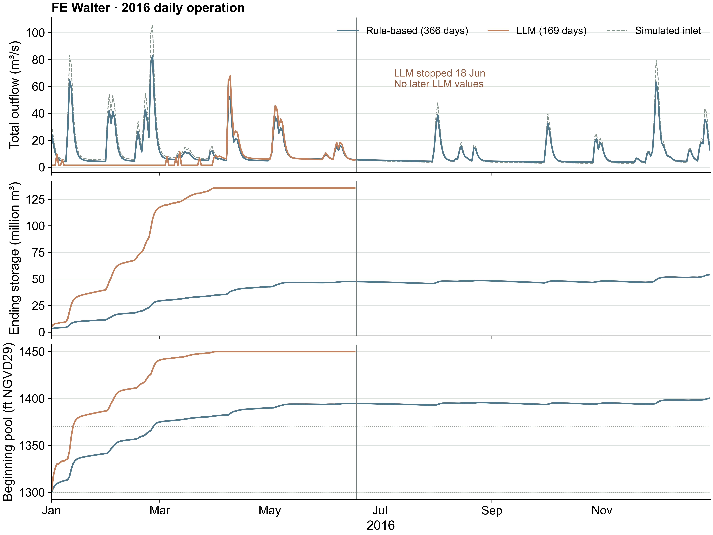

# Annual attempt: results and stopping point

**The rule-based run completed 366 days. The annual LLM test failed on June 18.**
Its 169 completed days remain available for inspection; they do not establish
a successful annual operating policy.

| Check | Observed result |
|---|---|
| Accepted weather, seven hydrological units and fixed parameters | Recomputed; [C&V reproduction](../../../../examples/fe_walter/hydrology.md#5-accepted-calibration-and-validation-results) agrees with retained metrics |
| Annual inlet and three method configurations | 366 dates; all configurations passed the input check without inference |
| Rule-based simulation | 366 committed days; formal verification passed; zero model requests |
| Retrieved-guidance LLM simulation | 169 committed days, January 1–June 17; failed before June 18 physics |
| Model requests | 170 of the authorized 366; no automatic retry or replacement method |

The live settings were `gemma3:4b`, temperature **0.7**, **2,048 output tokens**
and a 120-second timeout. This scientific run used **Python 3.14.0**; the
installation guide recommends Python 3.12. These are different runtime records.

## Read the trajectories

The LLM curve ends on June 17. The vertical marker identifies the failed June 18
request; no later values are filled or extrapolated. Total outflow is controlled
release plus spill. The 1300 and 1370 ft lines are reference elevations, not the
complete seasonal compliance criteria.

Download the [daily values](outputs/daily.csv),
or [machine-readable summary](outputs/attempt_summary.json).

## Why the LLM stopped

Ollama returned `done_reason: length` and `eval_count: 2048`. The response ended
inside an unterminated JSON reasoning string. It contained repeated numeric text,
but no valid, parseable release action. The response check rejected it.

The simulator did **not** extract a guessed release, apply June 18 reservoir
physics, retry the request or switch to a rule-based decision. The run remains
`FAILED`, with its raw response and committed journals preserved. No final
trajectory or network CSV was produced for this failed run.

Read the [complete captured failed reply](outputs/failed_reply_2016_06_18.txt).
For a valid response that still fails operating checks, follow the
[January 1 decision, messages and feedback](decision_2016_01_01.md).

A possible next experiment is a shorter response contract with the numeric action
before the explanation. That change and any new live test have **not** been
executed. Preserve this failed attempt and use a new run ID for any separately
authorized experiment.

## What passed through the daily loop

Across the **169 committed LLM days**, ending storage became the next day's
beginning storage with zero difference. The largest recomputed water-balance
residual was **2.98 × 10⁻⁸ m³**. The prior implemented total outflow in the next
prompt matched the physical journal to **7.11 × 10⁻¹⁵ m³/s**.

Requested release and total outflow differed on **75 days** because of spill.
For example:

| March 31 quantity | Value |
|---|---:|
| Inlet | 11.338457 m³/s |
| Requested and implemented controlled release | 1.415842 m³/s |
| Uncontrolled spill | 5.731249 m³/s |
| Total outflow | 7.147091 m³/s |
| Ending storage | 135,532,852.34 m³ |

The April 1 prompt records the prior decision as **50.0 cfs** and what was
actually released as **252.4 cfs**, including spill. Thus the next decision sees
implemented water movement, rather than the requested controlled release alone.

For the completed rule run, formal verification found zero difference between
the expected and native downstream routed flow, and a maximum system-balance
residual of **7.22 × 10⁻⁹ m³**. The separate direct CSV/journal recomputation
gave **7.45 × 10⁻⁹ m³** because of arithmetic ordering. The failed LLM attempt
has no final network CSV, so it does not have equivalent full-period downstream
verification.

## Execution is separate from operating performance

| Assessment | Rule-based, 366 days | LLM, 169 committed days |
|---|---:|---:|
| Original saved audit | 366 PASS | 169 FAIL |
| Common seasonal pool-band check | 1 PASS / 365 FAIL | 1 PASS / 168 FAIL |

The original audit suites differ by method, so their PASS rates are not a
matched policy comparison. The rule benchmark is a published flood-control
formulation, not a controller designed to meet this seasonal pool target.
The LLM's original FAIL reasons remain unchanged.

The common seasonal check uses beginning-of-day pool and the same date windows
for both methods. Fall decline is checked separately from pool-band bounds; the
LLM attempt did not reach fall. The assumed initial storage and `UH=[1]`
downstream routing also limit interpretation. These results demonstrate data
transfer and a visible failure, not acceptable reservoir operation.

## Resource observations

The saved live run occupies **15,913,939 bytes**. Ollama reported **553,843**
prompt-evaluation tokens and **46,547** generated tokens, including the failed
response. These are provider counters, not a billing estimate or a hardware
benchmark.

The host had an RTX 4080 SUPER with 16 GB GPU memory. A subsequent Ollama process
snapshot showed the model using the GPU and a server context of 64,000 tokens;
the experiment YAML did not set that context. This observation is not a minimum
hardware requirement. See [CPU, GPU, storage and interruption handling](../../../../docs/RUNNING.md).

## Reproduce the steps

Return to the [annual walkthrough](README.md) for preparation, method selection,
execution, verification and the corresponding source files. Its offline steps
do not make LLM requests. A fresh source-only dependency projection also
reproduced the inlet and the full rule-based trajectory byte for byte, without
using untracked research artifacts.
