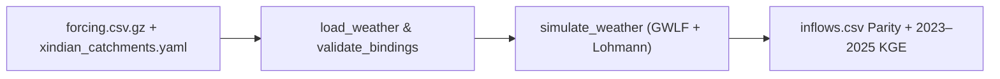

# Step 01: HydroCNHS Watershed Hydrology & Inflows

Inspect [`hydrology.yaml`](../../examples/multi_reservoir/hydrology/hydrology.yaml) and [`xindian_catchments.yaml`](../../examples/multi_reservoir/hydrology/xindian_catchments.yaml), verify zero overlapping subbasin bindings, and score 10-year (`2016–2025`) HydroCNHS (`GWLF + Lohmann`) performance against [`inflows.csv`](../../examples/multi_reservoir/inflows.csv).

> **Note:** Taiwan's Xindian River (`U1–U2`, `D1–D2`, TFRA & MOEA/WRA gauges) is a **repository-only example (not in the companion manuscript)**.



```sh
python -m jupyterlab tutorials/01_hydrocnhs_watershed_inflows/01_hydrocnhs_watershed_inflows.ipynb
```

Next: **[Step 02: Reservoir & Agent Setup](../02_reservoir_and_agent_setup/README.md)** · **[Tutorial Hub](../README.md)**
