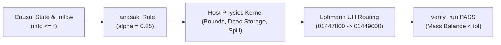
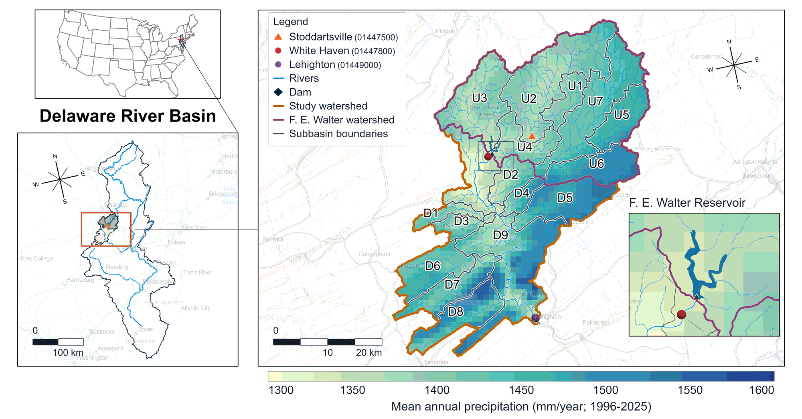

# Module 01: Offline Rule-Based Baseline (F.E. Walter Dam)

Verify **HydroReOpLLM**'s water-balance, physics clipping, and Lohmann routing kernel on **F.E. Walter Dam** (`2021`, 365 daily steps) with zero API calls before touching an LLM.



<p align="center">
  
</p>

| Step | Action | Output |
| --- | --- | --- |
| **1. Pool Zones** | Plot `elevation_storage.csv` operating bands & 2021 `inflows.csv` | Annotated rating curve (`1,300` / `1,370` / `1,450 ft`) |
| **2. Run & Verify** | Execute 365-day `rule_based.yaml` inside `TemporaryDirectory()` | `verify_run = PASS`, `0` network calls, mass-balance residual |
| **3. Inspect Drift** | Compare simulated pool level & release vs USGS `01447780` | 2-panel 2021 trajectory exposing seasonal refill drift |

```sh
python -m jupyterlab tutorials/01_setup_and_first_run/01_setup_and_rule_baseline.ipynb
```

Next: **[Module 02 — LLM Prompts & Operational Knowledge (DKP)](../02_prompt_and_knowledge_design/README.md)**
