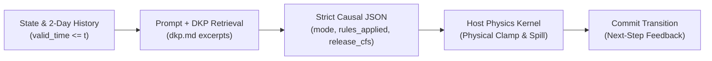

# Module 02: LLM Prompts, Schemas & Operational Knowledge (DKP)

Measure how adding structured Water Control Manual rules (`dkp.md`) changes 10-seed LLM reservoir skill vs `seasonal_target.yaml` on **F.E. Walter Dam** (`2021` offline replay).



| Step | Action | Output |
| --- | --- | --- |
| **1. Schema & Prompt** | Compare `seasonal_target.yaml` vs `dkp.yaml` via `load_settings` | Schema diff (`operating_mode`, `rules_applied`) & Day-1 causal JSON |
| **2. Replay 10 Seeds** | Replay `archived_releases.csv` (`20` LLM + `1` rule) offline | `verify_run = PASS` (`0` network calls), 3-gauge score table |
| **3. Compare Trade-Offs** | Plot 10-seed strip spread & IQR band against USGS observations | 3-gauge strip plot + 2021 IQR pool/release comparison |

```sh
python -m jupyterlab tutorials/02_prompt_and_knowledge_design/02_llm_prompt_and_knowledge.ipynb
```

Next: **[Module 03 — Watershed Hydrology, 10-Year C&V & Coupling](../03_watershed_hydrology_and_cv/README.md)**
