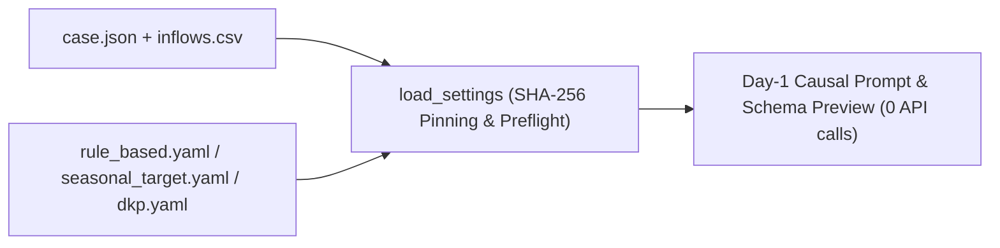

# Step 02: Reservoir Physics & Decision Agent Setup

Configure `case.json` storage/release bounds and routing UHs, then compare `rule_based.yaml` (`hanasaki`), `seasonal_target.yaml` (`prompts/`), and `dkp.yaml` (`dkp.md`) offline with `load_settings` (`check`).



```sh
python -m jupyterlab tutorials/02_reservoir_and_agent_setup/02_reservoir_and_agent_setup.ipynb
```

Next: **[Step 03: Run Single-Reservoir Simulation](../03_run_single_reservoir_simulation/README.md)** · **[Tutorial Hub](../README.md)**
