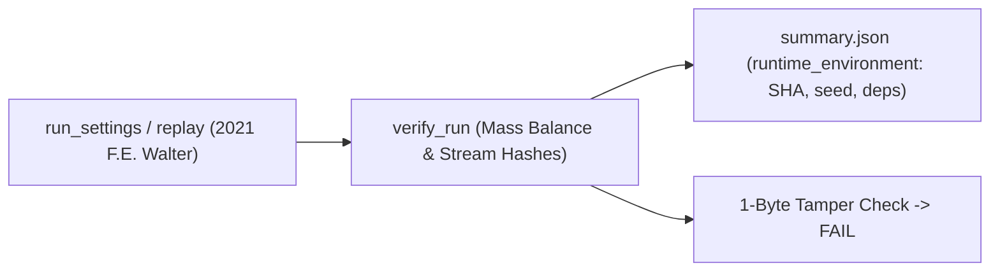

# Step 03: Run Single-Reservoir Simulation & Verify (F.E. Walter)

Execute the 2021 F.E. Walter Rule-based simulation (`run` → `verify`), compare 10-seed `seasonal_target` vs. `dkp` ensembles against USGS observations, and inspect host physics clamping, `summary.json["runtime_environment"]` (Ollama version, model SHA-256 digest, `seed`), and 1-byte tamper detection.



```sh
python -m jupyterlab tutorials/03_run_single_reservoir_simulation/03_run_single_reservoir_simulation.ipynb
```

Next: **[Step 04: Run Multi-Reservoir Cascade](../04_run_multi_reservoir_cascade/README.md)** · **[Tutorial Hub](../README.md)**
