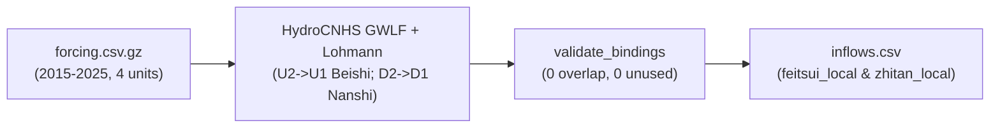
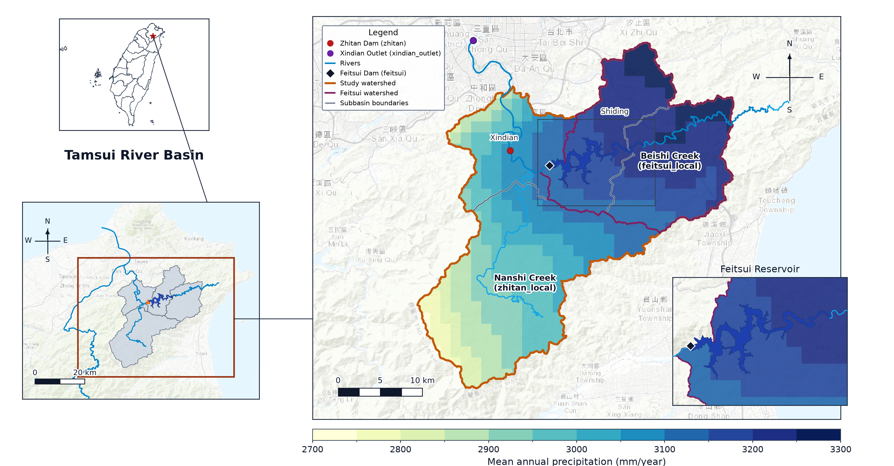

# Module 03: Watershed Hydrology, 10-Year C&V & Coupling

> **Repository-only example (not in the companion manuscript):** Taiwan's Xindian River basin (`2015–2025`, TFRA rain + ERA5 temp/PET).

Validate 11-year catchment forcing, enforce zero-overlap subbasin bindings, and verify 10-year HydroCNHS (`GWLF`) calibration/validation before coupling to reservoirs.



<p align="center">
  
</p>

| Step | Action | Output |
| --- | --- | --- |
| **1. Forcing & Bindings** | Run `load_weather` + `validate_bindings` on `hydrology.yaml` | Confirmed 4,018 days, `0` overlap between `feitsui_local` & `zhitan_local` |
| **2. Live C&V Parity** | Run `simulate_weather` & compare with `cv_summary.json` | Exact match vs `inflows.csv` + `r, alpha, beta` KGE decomposition |
| **3. High/Low Flow Skill** | Plot FDC (`2023–2025`) & 2025 cumulative closure vs TFRA | 2-panel FDC/KGE diagnostic + 2025 hydrograph & water balance |

```sh
python -m jupyterlab tutorials/03_watershed_hydrology_and_cv/03_hydrocnhs_cv_and_coupling.ipynb
```

Next: **[Module 04 — Multi-Reservoir Hybrid Cascade (Xindian River)](../04_multi_reservoir_hybrid_cascade/README.md)**
