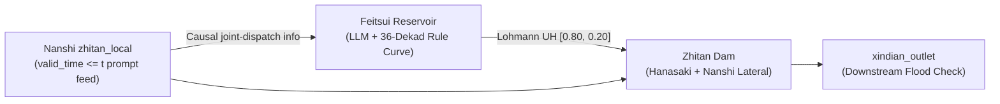
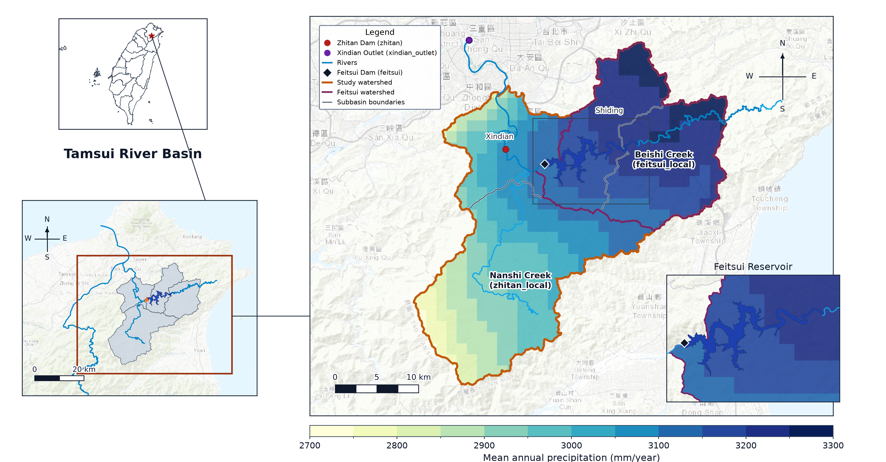

# Module 04: Multi-Reservoir Hybrid Cascade (`Feitsui → Zhitan`)

> **Repository-only example (not in the companion manuscript):** Taiwan's Xindian River 2-reservoir cascade across out-of-sample `2025` (TFRA observations & MOEA/WRA rule curve).

Couple an upstream joint-dispatch LLM (`feitsui`) with downstream Hanasaki control (`zhitan`) and Lohmann routing to test downstream storm peak shaving.



<p align="center">
  
</p>

| Step | Action | Output |
| --- | --- | --- |
| **1. Topology & Prompt** | Inspect `case.json`, `rule_curve.csv`, & Day-1 `hybrid_llm.yaml` prompt | Lohmann UH lags + causal Nanshi inflow in Day-1 prompt |
| **2. Dual Cascade Replay** | Run `rule_based.yaml` & offline `hybrid_llm.yaml` replay | `verify_run = PASS` on both cascades, UH convolution parity |
| **3. Storm & Full-Year Skill** | Plot peak 2025 storm zoom + full-year 3-panel trajectories | Peak-shaving zoom + 2025 trajectories vs TFRA & MOEA/WRA limits |

```sh
python -m jupyterlab tutorials/04_multi_reservoir_hybrid_cascade/04_xindian_hybrid_cascade.ipynb
```

Next: **[Module 05 — ODD+LLM Reproducibility & Tamper Audit](../05_odd_llm_reproducibility_and_audit/README.md)**
