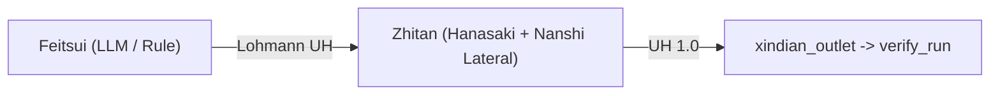

# Step 04: Run Coupled Multi-Reservoir Cascade (Xindian River)

Run full-year 2025 multi-reservoir cascades (`feitsui -> zhitan -> xindian_outlet`) comparing dual Hanasaki (`rule_based.yaml`) against upstream Feitsui LLM + downstream Zhitan Hanasaki (`hybrid_llm.yaml`), verify Lohmann convolution and zero mass-balance residuals, and inspect Typhoon Podul joint dispatch.

> **Note:** Repository-only example (**not in the companion manuscript**). Data credited to **TFRA** & **MOEA/WRA**.



```sh
python -m jupyterlab tutorials/04_run_multi_reservoir_cascade/04_run_multi_reservoir_cascade.ipynb
```

Back to: **[Tutorial Hub](../README.md)** · **[Multi-Reservoir Case](../../examples/multi_reservoir/README.md)**
