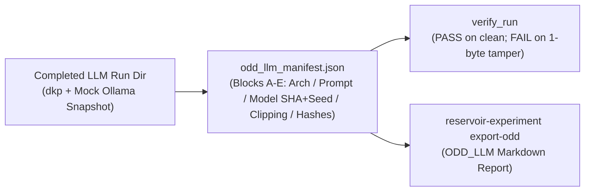
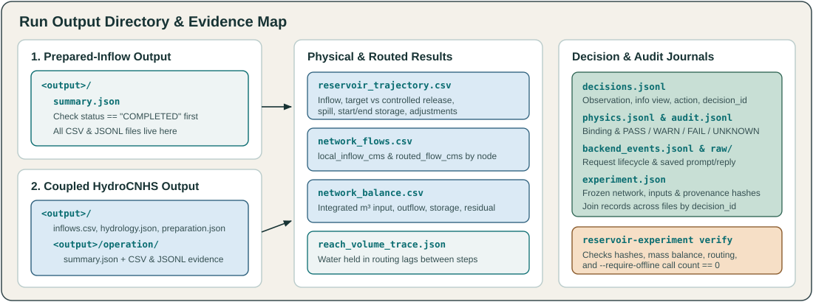

# Module 05: ODD+LLM Reproducibility & Tamper Audit

Audit an **F.E. Walter LLM (`dkp`)** run with `odd_llm_manifest.json` (CoALA Blocks A–E), verify Ollama version/model digest SHA/seed provenance, inspect host physics clamping, and prove 1-byte tamper detection.



<p align="center">
  
</p>

| Step | Action | Output |
| --- | --- | --- |
| **1. Blocks A–E Provenance** | Run mocked-Ollama `dkp` audit demo & export `odd_llm_manifest.json` | 5-block provenance table (Ollama `0.40.6`, weights SHA, `seed=3`) |
| **2. Closure & Clamping** | Plot network + `reach_volume_trace` closure & Day-5 clamp | Full-network closure chart & requested vs clamped release plot |
| **3. Tamper -> FAIL** | Flip 1 byte in saved trajectory CSV & re-run `verify_run` | Immediate hash-mismatch failure (`tamper_caught = True`) |

```sh
python -m jupyterlab tutorials/05_odd_llm_reproducibility_and_audit/05_odd_llm_reproducibility.ipynb
reservoir-experiment verify <run_dir> --require-offline
reservoir-experiment export-odd <run_dir> --markdown-out ODD_LLM.md
```

Back to: **[Tutorial Curriculum Hub](../README.md)** · **[Reading Results & ODD+LLM](../../docs/RESULTS_GUIDE.md)**
