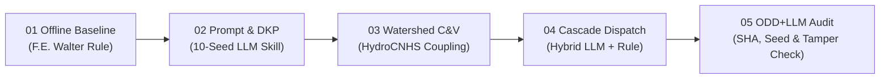

# HydroReOpLLM Step-by-Step Tutorials

All 5 modules run **100% offline (`0` API cost)** inside temporary folders and ship with pre-rendered diagnostic plots.

<p align="center">
  
  <br>
  <em>HydroCNHS watershed inflows and physical limits stay fixed while you swap Rule-based, Python, or LLM reservoir operators.</em>
</p>

## Learning Roadmap



## Choose a Module by Question

| Module | Question It Answers | Basin | Start |
| --- | --- | --- | --- |
| **01** | Does the water-balance & routing engine close mass balance? | F.E. Walter (`2021`, paper benchmark) | [Guide](01_setup_and_first_run/README.md) · [Notebook](01_setup_and_first_run/01_setup_and_rule_baseline.ipynb) |
| **02** | Does operational knowledge (`dkp.md`) improve 10-seed LLM skill? | F.E. Walter (`2021`, offline replay) | [Guide](02_prompt_and_knowledge_design/README.md) · [Notebook](02_prompt_and_knowledge_design/02_llm_prompt_and_knowledge.ipynb) |
| **03** | How do I couple and verify a multi-subbasin HydroCNHS watershed? | Taiwan Xindian River (`2016–2025`, **repo-only — not in paper**) | [Guide](03_watershed_hydrology_and_cv/README.md) · [Notebook](03_watershed_hydrology_and_cv/03_hydrocnhs_cv_and_coupling.ipynb) |
| **04** | How do I coordinate an upstream LLM dam with a downstream rule dam? | Taiwan Xindian River (`2025`, **repo-only — not in paper**) | [Guide](04_multi_reservoir_hybrid_cascade/README.md) · [Notebook](04_multi_reservoir_hybrid_cascade/04_xindian_hybrid_cascade.ipynb) |
| **05** | How do I prove reproducibility (`ODD+LLM`, Ollama/model SHA, tamper check)? | F.E. Walter (`dkp` offline LLM audit) | [Guide](05_odd_llm_reproducibility_and_audit/README.md) · [Notebook](05_odd_llm_reproducibility_and_audit/05_odd_llm_reproducibility.ipynb) |
| **Sandbox** | Optional: Paper Figure 3 reproduction & live local Ollama playground | F.E. Walter (`2021`) | [Notebook (`fe_walter.ipynb`)](fe_walter.ipynb) |

## Adapt to Your Own Basin (Zero-Python Public Schema)

| Layer | Swap These Files | Schema / CLI Note |
| --- | --- | --- |
| **Watershed inflows** | `inflows.csv` or `hydrology.yaml` | `reservoir-experiment prepare` (`routed:` vs `runoff:`, 0 overlap) |
| **Dam physics & routing** | `case.json` / `reservoirs.yaml` | SI units (`m3`, `m3/s`), `8.0e+6` YAML syntax, UH sum = `1.0` |
| **Operator policy** | `rule_based.yaml` or `type: llm` + `prompts/` + `dkp.md` | Public `reservoir-action.v1` JSON (`study/formatter.py` optional) |
| **Live LLM switch** | `models.yaml` + `information.yaml` | `ollama pull gemma4:12b`, set `max_calls`, run `--allow-network` |
| **Peer-review bundle** | `odd_llm_manifest.json` + `archived_releases.csv` | `verify --require-offline` & `export-odd --markdown-out ODD_LLM.md` |

## Launch Locally

```sh
python -m pip install -c environment/requirements-bundled.txt . jupyterlab ipykernel
python -m jupyterlab tutorials/01_setup_and_first_run/01_setup_and_rule_baseline.ipynb
```

Select the `.venv` kernel and run **Run → Run All Cells**. Reference manuals: [Installation & CLI](../docs/GETTING_STARTED.md) · [Reading Results & ODD+LLM](../docs/RESULTS_GUIDE.md) · [F.E. Walter](../examples/fe_walter/README.md) · [Xindian River](../examples/multi_reservoir/README.md).
