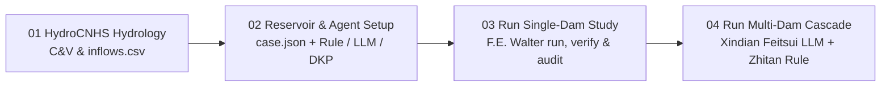

# HydroReOpLLM Step-by-Step Tutorials

All 4 modules run **100% offline (`0` API cost)** inside temporary directories and follow the natural modeling sequence: **HydroCNHS Hydrology → Agent Setup → Single-Dam Run → Multi-Dam Cascade**.

## Learning Path



| Step | Topic & Focus | Basin & Case | Entry |
| --- | --- | --- | --- |
| **01** | **HydroCNHS Watershed Hydrology**: inspect `hydrology.yaml` & `xindian_catchments.yaml`, verify zero overlapping units, score 10-yr C&V (`KGE`), and check `inflows.csv` parity. | Taiwan Xindian River (`2016–2025`, **repo-only — not in paper**; TFRA & MOEA/WRA) | [Guide](01_hydrocnhs_watershed_inflows/README.md) · [Notebook](01_hydrocnhs_watershed_inflows/01_hydrocnhs_watershed_inflows.ipynb) |
| **02** | **Reservoir Physics & Agent Setup**: inspect `case.json` storage/release/UH limits, compare `rule_based.yaml`, `seasonal_target.yaml`, and `dkp.yaml` (`prompts/`, `dkp.md`), and run offline `check`. | F.E. Walter Dam (`2021`, paper benchmark) | [Guide](02_reservoir_and_agent_setup/README.md) · [Notebook](02_reservoir_and_agent_setup/02_reservoir_and_agent_setup.ipynb) |
| **03** | **Execute Single-Reservoir Simulation & Verify**: run full 2021 `run` → `verify`, compare Rule-based vs. 10-seed LLM results, and inspect clamping, `runtime_environment` (Ollama SHA & `seed`), and tamper checks. | F.E. Walter Dam (`2021`) | [Guide](03_run_single_reservoir_simulation/README.md) · [Notebook](03_run_single_reservoir_simulation/03_run_single_reservoir_simulation.ipynb) |
| **04** | **Execute Multi-Reservoir Cascade**: couple upstream Feitsui LLM + Lohmann UH routing + downstream Zhitan Hanasaki across 2025, verify closed water balance, and inspect Typhoon Podul joint dispatch. | Taiwan Xindian River (`2025`, **repo-only — not in paper**) | [Guide](04_run_multi_reservoir_cascade/README.md) · [Notebook](04_run_multi_reservoir_cascade/04_run_multi_reservoir_cascade.ipynb) |
| **Optional** | Full 2021 Figure 3 walkthrough + optional local Ollama live inference test. | F.E. Walter Dam (`2021`) | [Notebook (`fe_walter.ipynb`)](fe_walter.ipynb) |

## Four Key Config Layers for Your Own Basin

1. **Experiment entry YAML** (`<name>.yaml` or `experiment.yaml`): simulation dates, `case`, `models`, `agents`, `max_calls`, `output`.
2. **Hydrology & inflows** (`hydrology/hydrology.yaml` + catchment YAML + `forcing.csv(.gz)`, or direct `inflows.csv`).
3. **Reservoir network physics** (`case.json` or `reservoirs.yaml`): storage bounds, release limits, `unit_hydrograph` (`8.0e+6`, UH sum `= 1.0`).
4. **Decision agents** (`*_statistics.json` for Hanasaki, or `prompts/*.txt`, optional `dkp.md`, optional `information.yaml`).

```sh
python -m pip install -c environment/requirements-bundled.txt . jupyterlab ipykernel
python -m jupyterlab tutorials/01_hydrocnhs_watershed_inflows/01_hydrocnhs_watershed_inflows.ipynb
```

See also: [Installation & CLI](../docs/GETTING_STARTED.md) · [Key Configs & File Map](../docs/CONFIGURATION.md) · [Reading Results](../docs/RESULTS_GUIDE.md).
