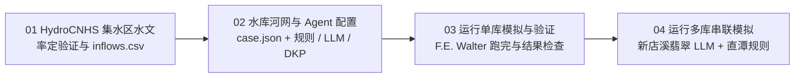

# HydroReOpLLM 实战教程（4 步流程）

全系列 4 堂实战课均可 **100% 离线运行（`0` API 费用）**，所有模拟仅在临时目录中执行，并已预存高分辨率结果图表。学习顺序直接对应真实建模流程：**HydroCNHS 集水区水文 → 水库与 Agent 配置 → 单库模拟跑完验证 → 多库串联耦合实战**。

## 学习路线图



| 步骤 | 课程主题与关键文件 | 示范流域 | 入口 |
| --- | --- | --- | --- |
| **01** | **HydroCNHS 集水区水文**：检查 `hydrology.yaml` 与 `xindian_catchments.yaml`、确认子集水区零重叠、检验 10 年率定验证与 `inflows.csv` 一致性。 | 台湾新店溪（`2016–2025`，**仓库专属示例，未收录于论文**；TFRA／经济部水利署） | [简中导读](01_hydrocnhs_watershed_inflows/README.zh-CN.md) · [Notebook](01_hydrocnhs_watershed_inflows/01_hydrocnhs_watershed_inflows.ipynb) |
| **02** | **水库物理与 Agent 配置**：检查 `case.json` 库容／上下限／单位线，对比 `rule_based.yaml`、`seasonal_target.yaml`、`dkp.yaml`（`prompts/`、`dkp.md`）并离线执行 `check`。 | F.E. Walter（`2021`，论文基准） | [简中导读](02_reservoir_and_agent_setup/README.zh-CN.md) · [Notebook](02_reservoir_and_agent_setup/02_reservoir_and_agent_setup.ipynb) |
| **03** | **运行单库模拟与结果验证**：实际运行 `run` → `verify`、对比规则与 10-seed LLM 表现，并查看物理限幅、`summary.json` 内的模型 SHA／`seed` 记录与篡改检测。 | F.E. Walter（`2021`） | [简中导读](03_run_single_reservoir_simulation/README.zh-CN.md) · [Notebook](03_run_single_reservoir_simulation/03_run_single_reservoir_simulation.ipynb) |
| **04** | **运行多库串联耦合模拟**：将上游翡翠水库 LLM、3 日 Lohmann 河道演进与下游直潭坝 Hanasaki 串接跑完 2025 全年，验证水量平衡闭合与台风联合防洪。 | 台湾新店溪（`2025`，**仓库专属示例，未收录于论文**） | [简中导读](04_run_multi_reservoir_cascade/README.zh-CN.md) · [Notebook](04_run_multi_reservoir_cascade/04_run_multi_reservoir_cascade.ipynb) |
| **选修** | 论文 Figure 3 完整复现与本地 Ollama 实机联网测试沙盒。 | F.E. Walter（`2021`） | [Notebook (`fe_walter.ipynb`)](fe_walter.ipynb) |

## 套用到自己流域的 4 个关键配置文件

1. **主实验 YAML**（`<实验名>.yaml` 或 `experiment.yaml`）：模拟起止日、`case`、`models`、`agents`、`max_calls`、`output`。
2. **水文与入流**（`hydrology/hydrology.yaml` + HydroCNHS YAML + `forcing.csv(.gz)`，或直接提供 `inflows.csv`）。
3. **水库河网物理**（`case.json` 或 `reservoirs.yaml`）：库容、下泄约束、`unit_hydrograph`（科学计数法写 `8.0e+6`、UH 总和 `= 1.0`）。
4. **决策 Agent**（Hanasaki 用 `*_statistics.json`，或 LLM 用 `prompts/*.txt` ＋ 可选 `dkp.md` ＋ 可选 `information.yaml`）。

```sh
python -m pip install -c environment/requirements-bundled.txt . jupyterlab ipykernel
python -m jupyterlab tutorials/01_hydrocnhs_watershed_inflows/01_hydrocnhs_watershed_inflows.ipynb
```

延伸阅读：[安装与 CLI 命令](../docs/GETTING_STARTED.zh-CN.md) · [关键配置文件总览](../docs/CONFIGURATION.zh-CN.md) · [结果解读与运行信息](../docs/RESULTS_GUIDE.zh-CN.md)。
