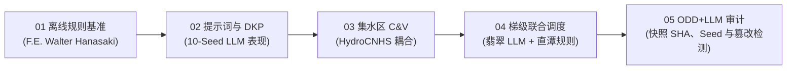

# HydroReOpLLM 实战教程课程

全系列 5 个模块均可 **100% 离线运行（`0` API 费用）**，所有输出仅写入系统临时目录，并已预生成清晰诊断图表，打开即可直接查看。

<p align="center">
  
  <br>
  <em>固定 HydroCNHS 集水区入流、物理约束与河道演进，安全替换 Rule-based、自定义 Python 或 LLM 水库调度员。</em>
</p>

## 学习路线图



## 按核心问题选择实战模块

| 模块 | 本章回答的核心问题 | 示例流域 | 入口 |
| --- | --- | --- | --- |
| **01** | 水库水量平衡与河道演进引擎是否严格闭合？ | F.E. Walter（`2021`，论文基准） | [导读](01_setup_and_first_run/README.md) · [Notebook](01_setup_and_first_run/01_setup_and_rule_baseline.ipynb) |
| **02** | 引入水库运行规程（`dkp.md`）能否提升 10-seed LLM 调度表现？ | F.E. Walter（`2021`，离线回放） | [导读](02_prompt_and_knowledge_design/README.md) · [Notebook](02_prompt_and_knowledge_design/02_llm_prompt_and_knowledge.ipynb) |
| **03** | 如何率定验证多子集水区 HydroCNHS 并确保无重叠耦合入流？ | 台湾新店溪（`2016–2025`，**仓库专属示例，未收录于论文**） | [导读](03_watershed_hydrology_and_cv/README.md) · [Notebook](03_watershed_hydrology_and_cv/03_hydrocnhs_cv_and_coupling.ipynb) |
| **04** | 如何串联上游 LLM（翡翠水库）与下游规则坝（直潭坝）并验证联合防洪？ | 台湾新店溪（`2025`，**仓库专属示例，未收录于论文**） | [导读](04_multi_reservoir_hybrid_cascade/README.md) · [Notebook](04_multi_reservoir_hybrid_cascade/04_xindian_hybrid_cascade.ipynb) |
| **05** | 如何证明实验可复现性（ODD+LLM、Ollama/模型 SHA、Seed 与篡改检测）？ | F.E. Walter（`dkp` 离线 LLM 审计） | [导读](05_odd_llm_reproducibility_and_audit/README.md) · [Notebook](05_odd_llm_reproducibility_and_audit/05_odd_llm_reproducibility.ipynb) |
| **沙盒** | 可选：论文 Figure 3 复现与本地 Ollama 实机调用体验 | F.E. Walter（`2021`） | [Notebook (`fe_walter.ipynb`)](fe_walter.ipynb) |

## 替换为您的专属流域（零 Python 公共配置架构）

| 替换层级 | 编辑这些文件 | 公共 Schema ／ CLI 要点 |
| --- | --- | --- |
| **集水区与入流** | `inflows.csv` 或 `hydrology.yaml` | `reservoir-experiment prepare`（`routed:`／`runoff:` 零重叠） |
| **水库物理与演进** | `case.json`／`reservoirs.yaml` | 统一采用 SI 单位（`m3`、`m3/s`）、科学计数法写 `8.0e+6`、UH 总和 `= 1.0` |
| **调度策略与知识** | `rule_based.yaml` 或 `type: llm` + `prompts/` + `dkp.md` | 公共 `reservoir-action.v1`（`study/formatter.py` 仅用于论文英制单位扩展） |
| **切换本地 Ollama** | `models.yaml` + `information.yaml` | `ollama pull gemma4:12b`，调高 `max_calls` 并添加 `--allow-network` |
| **审稿人回放与审计** | `odd_llm_manifest.json` + `archived_releases.csv` | `verify --require-offline` 与 `export-odd --markdown-out ODD_LLM.md` |

## 本地启动方式

```sh
python -m pip install -c environment/requirements-bundled.txt . jupyterlab ipykernel
python -m jupyterlab tutorials/01_setup_and_first_run/01_setup_and_rule_baseline.ipynb
```

在右上角选择 `.venv` 内核后点击 **Run → Run All Cells**。延伸阅读：[安装与 CLI 命令](../docs/GETTING_STARTED.zh-CN.md) · [结果解读与 ODD+LLM](../docs/RESULTS_GUIDE.zh-CN.md) · [F.E. Walter 案例](../examples/fe_walter/README.zh-CN.md) · [新店溪案例（TFRA / 经济部水利署）](../examples/multi_reservoir/README.zh-CN.md)。
