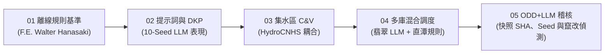

# HydroReOpLLM 實作教學課程

全系列 5 個單元皆可 **100% 離線執行（`0` API 費用）**，所有運算僅寫入系統暫存資料夾，且已預存高解析度診斷圖表，開箱即可瀏覽。

<p align="center">
  
  <br>
  <em>固定 HydroCNHS 集水區入流、物理限制與河道演算，安全抽換 Rule-based、自訂 Python 或 LLM 水庫操作員。</em>
</p>

## 學習路線圖



## 依問題挑選實作模組

| 模組 | 這一章回答的核心問題 | 示範流域 | 入口 |
| --- | --- | --- | --- |
| **01** | 水庫水量平衡與河道演算引擎是否嚴格守恆？ | F.E. Walter（`2021`，論文基準） | [導讀](01_setup_and_first_run/README.md) · [Notebook](01_setup_and_first_run/01_setup_and_rule_baseline.ipynb) |
| **02** | 加入水庫運用要點（`dkp.md`）能否提升 10-seed LLM 調度表現？ | F.E. Walter（`2021`，離線重播） | [導讀](02_prompt_and_knowledge_design/README.md) · [Notebook](02_prompt_and_knowledge_design/02_llm_prompt_and_knowledge.ipynb) |
| **03** | 如何率定驗證多子集水區 HydroCNHS 並無重疊耦合入流？ | 台灣新店溪（`2016–2025`，**Repo 專屬範例，未收錄於論文**） | [導讀](03_watershed_hydrology_and_cv/README.md) · [Notebook](03_watershed_hydrology_and_cv/03_hydrocnhs_cv_and_coupling.ipynb) |
| **04** | 如何串聯上游 LLM（翡翠）與下游規則水庫（直潭）並驗證聯合防洪？ | 台灣新店溪（`2025`，**Repo 專屬範例，未收錄於論文**） | [導讀](04_multi_reservoir_hybrid_cascade/README.md) · [Notebook](04_multi_reservoir_hybrid_cascade/04_xindian_hybrid_cascade.ipynb) |
| **05** | 如何證明可重現性（ODD+LLM、Ollama/模型 SHA、Seed 與竄改抓錯）？ | F.E. Walter（`dkp` 離線 LLM 稽核） | [導讀](05_odd_llm_reproducibility_and_audit/README.md) · [Notebook](05_odd_llm_reproducibility_and_audit/05_odd_llm_reproducibility.ipynb) |
| **沙盒** | 選修：論文 Figure 3 重現與本機 Ollama 實機呼叫測試 | F.E. Walter（`2021`） | [Notebook (`fe_walter.ipynb`)](fe_walter.ipynb) |

## 套用到您的專屬流域（免寫 Python 公版架構）

| 抽換層級 | 替換這些檔案 | 公版 Schema ／ CLI 要點 |
| --- | --- | --- |
| **集水區與入流** | `inflows.csv` 或 `hydrology.yaml` | `reservoir-experiment prepare`（`routed:`／`runoff:` 零重疊） |
| **水庫物理與演算** | `case.json`／`reservoirs.yaml` | 統一採 SI 單位（`m3`、`m3/s`）、科學記號寫 `8.0e+6`、UH 總和 `= 1.0` |
| **操作策略與知識** | `rule_based.yaml` 或 `type: llm` + `prompts/` + `dkp.md` | 公版 `reservoir-action.v1`（`study/formatter.py` 僅供英制論文擴充） |
| **切換本機 Ollama** | `models.yaml` + `information.yaml` | `ollama pull gemma4:12b`，調高 `max_calls` 並加上 `--allow-network` |
| **審稿人重播與稽核** | `odd_llm_manifest.json` + `archived_releases.csv` | `verify --require-offline` 與 `export-odd --markdown-out ODD_LLM.md` |

## 本機啟動方式

```sh
python -m pip install -c environment/requirements-bundled.txt . jupyterlab ipykernel
python -m jupyterlab tutorials/01_setup_and_first_run/01_setup_and_rule_baseline.ipynb
```

切換右上角 `.venv` 核心後點擊 **Run → Run All Cells**。延伸閱讀：[安裝與 CLI 指令](../docs/GETTING_STARTED.zh-TW.md) · [結果判讀與 ODD+LLM](../docs/RESULTS_GUIDE.zh-TW.md) · [F.E. Walter 案例](../examples/fe_walter/README.zh-TW.md) · [新店溪案例（TFRA / 經濟部水利署）](../examples/multi_reservoir/README.zh-TW.md)。
