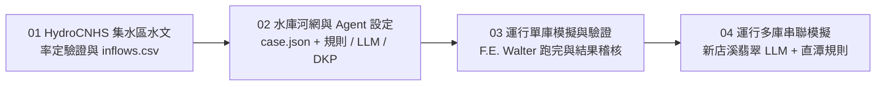

# HydroReOpLLM 實作教學課程（4 步驟流程）

全系列 4 堂實作課皆可 **100% 離線執行（`0` API 費用）**，所有模擬只在暫存資料夾進行，並已預存高解析度結果圖表。學習順序直接對應真實建模流程：**HydroCNHS 集水區水文 → 水庫與 Agent 設定 → 單庫模擬跑完驗證 → 多庫串聯耦合實戰**。

## 學習路線圖



| 步驟 | 課程主題與關鍵檔案 | 示範流域 | 入口 |
| --- | --- | --- | --- |
| **01** | **HydroCNHS 集水區水文**：檢視 `hydrology.yaml` 與 `xindian_catchments.yaml`、確認子集水區零重疊、檢驗 10 年率定驗證與 `inflows.csv` 一致性。 | 台灣新店溪（`2016–2025`，**Repo 專屬範例，未收錄於論文**；TFRA／經濟部水利署） | [繁中導讀](01_hydrocnhs_watershed_inflows/README.zh-TW.md) · [Notebook](01_hydrocnhs_watershed_inflows/01_hydrocnhs_watershed_inflows.ipynb) |
| **02** | **水庫物理與 Agent 設定**：檢視 `case.json` 庫容／上下限／單位歷線，比較 `rule_based.yaml`、`seasonal_target.yaml`、`dkp.yaml`（`prompts/`、`dkp.md`）並離線執行 `check`。 | F.E. Walter（`2021`，論文基準） | [繁中導讀](02_reservoir_and_agent_setup/README.zh-TW.md) · [Notebook](02_reservoir_and_agent_setup/02_reservoir_and_agent_setup.ipynb) |
| **03** | **運行單庫模擬與結果驗證**：實際執行 `run` → `verify`、比較規則與 10-seed LLM 表現，並檢視物理限幅、`summary.json` 內的模型 SHA／`seed` 紀錄與竄改偵測。 | F.E. Walter（`2021`） | [繁中導讀](03_run_single_reservoir_simulation/README.zh-TW.md) · [Notebook](03_run_single_reservoir_simulation/03_run_single_reservoir_simulation.ipynb) |
| **04** | **運行多庫串聯耦合模擬**：將上游翡翠 LLM、3 日 Lohmann 河道演算與下游直潭 Hanasaki 串接跑完 2025 全年，驗證水量平衡閉合與颱風聯合防洪。 | 台灣新店溪（`2025`，**Repo 專屬範例，未收錄於論文**） | [繁中導讀](04_run_multi_reservoir_cascade/README.zh-TW.md) · [Notebook](04_run_multi_reservoir_cascade/04_run_multi_reservoir_cascade.ipynb) |
| **選修** | 論文 Figure 3 完整重現與本機 Ollama 實機連線測試沙盒。 | F.E. Walter（`2021`） | [Notebook (`fe_walter.ipynb`)](fe_walter.ipynb) |

## 套用到自己流域的 4 個關鍵設定檔

1. **主實驗 YAML**（`<實驗名>.yaml` 或 `experiment.yaml`）：模擬起訖日、`case`、`models`、`agents`、`max_calls`、`output`。
2. **水文與入流**（`hydrology/hydrology.yaml` + HydroCNHS YAML + `forcing.csv(.gz)`，或直接給 `inflows.csv`）。
3. **水庫河網物理**（`case.json` 或 `reservoirs.yaml`）：庫容、放流限制、`unit_hydrograph`（科學記號寫 `8.0e+6`、UH 總和 `= 1.0`）。
4. **決策 Agent**（Hanasaki 用 `*_statistics.json`，或 LLM 用 `prompts/*.txt` ＋ 選填 `dkp.md` ＋ 選填 `information.yaml`）。

```sh
python -m pip install -c environment/requirements-bundled.txt . jupyterlab ipykernel
python -m jupyterlab tutorials/01_hydrocnhs_watershed_inflows/01_hydrocnhs_watershed_inflows.ipynb
```

延伸閱讀：[安裝與 CLI 指令](../docs/GETTING_STARTED.zh-TW.md) · [關鍵設定檔總覽](../docs/CONFIGURATION.zh-TW.md) · [結果判讀與運行資訊](../docs/RESULTS_GUIDE.zh-TW.md)。
