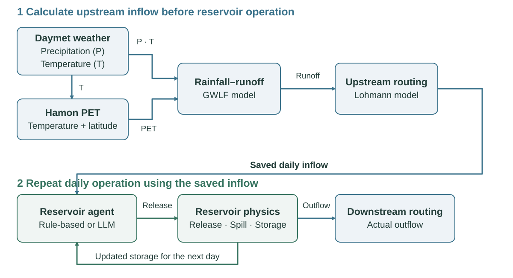
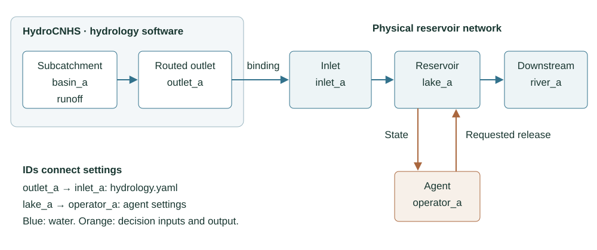
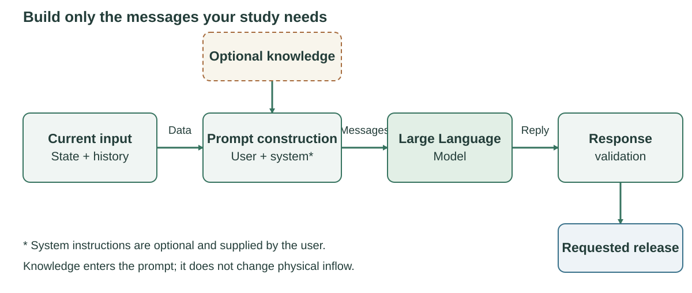
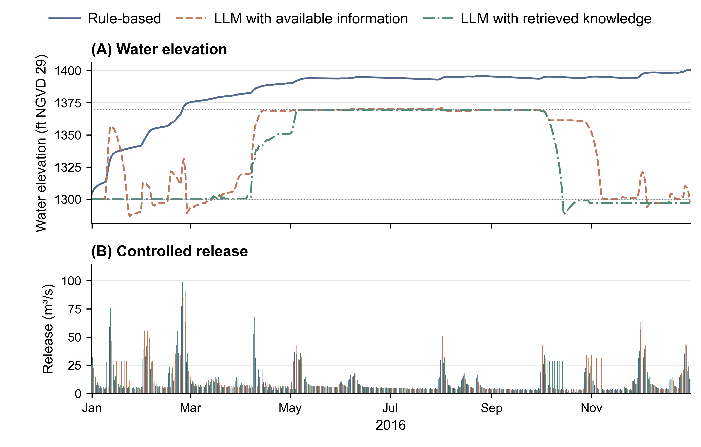

# F.E. Walter: weather, hydrology, and daily operation

This is the maintained tutorial source for the F.E. Walter research example.
It uses the same inflow, initial state, and physical parameters for **Rule-based**,
**LLM with available information**, and **LLM with retrieved knowledge**.



**Figure 1.** Daymet supplies precipitation (**P**, mm/day) and temperature
(**T**, °C); documented nClimGrid patches cover the retained calendar gaps, and
Hamon supplies PET (cm/day). Weather preparation and HydroCNHS routing are
upstream precomputation. The daily operation loop receives the resulting inflow,
asks the selected operator for release, and advances shared reservoir physics.

## 1. Begin at `experiment.yaml`

Run commands from the repository root. The current Rule-based entry is
[`coupled/current/experiment.yaml`](../examples/fe_walter/coupled/current/experiment.yaml).
It declares the 2016 dates, physical case, output identity, hydrology, agents,
auditors, and registered rule extension.

```{literalinclude} ../examples/fe_walter/coupled/current/experiment.yaml
:language: yaml
```

The two LLM entries retain the same case and hydrology:

- [`llm_available.yaml`](../examples/fe_walter/coupled/current/llm_available.yaml)
- [`llm_knowledge.yaml`](../examples/fe_walter/coupled/current/llm_knowledge.yaml)

Choose a new `run_id` and output path for any new execution. Resource paths are
relative to the file that declares them.

## 2. Connect accepted hydrology

[`hydrology.yaml`](../examples/fe_walter/coupled/hydrology.yaml) points to the
accepted HydroCNHS model and forcing. The weather path uses daily precipitation,
temperature, and precomputed PET for seven contributing subcatchments. GWLF
produces runoff and Lohmann routing moves it to the aggregation outlet. The
binding supplies that routed flow to operation inlet `FEW_INFLOW`.

```{literalinclude} ../examples/fe_walter/coupled/hydrology.yaml
:language: yaml
```

The accepted native series covers 1989–2025; this experiment selects the 366
days of 2016. Changing the reservoir operator does not recalibrate hydrology.
See [hydrology, parameters, and C&V](../examples/fe_walter/hydrology.md) for data
sources, calibration, validation, and limits.

## 3. Map hydrology, reservoir, and agent IDs



**Figure 2.** Generic ID mapping between hydrology, a reservoir, and its agent.
The table below gives the F.E. Walter IDs.

[`reservoirs.json`](../examples/fe_walter/coupled/reservoirs.json) uses several
identifiers with distinct roles:

| ID | Role |
|---|---|
| `FEW-D-01`, etc. | HydroCNHS contributing units. |
| `FEW_INFLOW` | Operation-network inlet. |
| `FEWalter` | Reservoir graph key; the agent must use this value as `reservoir_id`. |
| `fe_walter` | Physical case/profile ID. |
| `fe_operator` | Agent instance and state/history owner. |
| `Downstream` | Terminal routing node. |

The physical initial storage is 2,457,848.279729185 m³. It is an integration
assumption, not an observed 1 January 2016 pool measurement. The daily step is
86,400 s; direct reservoir precipitation, evaporation, seepage, and withdrawals
are zero. Downstream `UH=[1.0]` is identity routing, not calibrated travel time.

```{literalinclude} ../examples/fe_walter/coupled/reservoirs.json
:language: json
```

| JSON field | Role |
|---|---|
| `network.reservoirs.FEWalter.inflow_node` | Binds prepared flow from `FEW_INFLOW`. |
| `physical.initial_storage_m3` | Sets the independent start state for each method. |
| `physical.minimum_release_cms`, `maximum_release_cms` | Bound implemented controlled release. |
| `connections[].unit_hydrograph` | Routes total outflow to the next node. |
| `outlet` | Names the terminal operation-network node. |

See the [parameter reference](../docs/PARAMETER_REFERENCE.md) for all public
fields. The code path is
[`configuration.py`](../src/llm_reservoir_agent/configuration.py) →
[`coupled.py`](../src/llm_reservoir_agent/coupled.py) →
[`agent_configuration.py`](../src/llm_reservoir_agent/agent_configuration.py) →
[`configured_backend.py`](../src/llm_reservoir_agent/configured_backend.py) →
[`agent.py`](../src/llm_reservoir_agent/agent.py) →
[`experiment.py`](../src/llm_reservoir_agent/experiment.py).

## 4. Select Rule-based or LLM operation

The Rule-based agent selects the registered Hanasaki-style case rule. The two
LLM agents use the same daily decision interface.

```{literalinclude} ../examples/fe_walter/coupled/agents.rule.yaml
:language: yaml
```

The available-information agent binds the prompt and model profile:

```{literalinclude} ../examples/fe_walter/coupled/agents.llm_available.yaml
:language: yaml
```

The available-information method receives the current date, inflow, starting
water elevation, seasonal instruction, and short completed-decision history.
The retrieved-knowledge agent adds the configured context provider:

```{literalinclude} ../examples/fe_walter/coupled/agents.llm_knowledge.yaml
:language: yaml
```

Model identity, sampling controls, context size, timeout, and attempt limit live
in the model profile. They are provenance settings rather than method names.

```{literalinclude} ../examples/fe_walter/coupled/current/models.yaml
:language: yaml
```

## 5. Read prompt and knowledge assembly



**Figure 3.** Retrieved knowledge adds context to the prompt; system instructions
are optional and user-supplied. The two methods use six- and eight-field raw
response schemas, respectively; both return a release proposal to shared physics.

The available-information prompt defines the task and structured response:

```{literalinclude} ../examples/fe_walter/prompts/zeroshot_seasonal_v1_system.txt
:language: text
```

The retrieved-knowledge method uses the current v2 prompt and the configured
knowledge provider:

```{literalinclude} ../examples/fe_walter/prompts/dkp_seasonal_v2_system.txt
:language: text
```

The model proposes a release. The case parser converts cfs to m³/s before shared
physics applies water availability and release limits, computes spill and end
storage, and supplies the next day's state. The model does not calculate
catchment inflow or water balance.

## 6. Check, prepare, run, and verify

`check` resolves configuration without hydrology or provider access. `prepare`
computes the selected hydrology. An LLM run requires the explicit network flag.

```powershell
reservoir-experiment check examples/fe_walter/coupled/current/experiment.yaml
reservoir-experiment prepare examples/fe_walter/coupled/current/experiment.yaml
reservoir-experiment run examples/fe_walter/coupled/current/experiment.yaml
reservoir-experiment verify runs/fe-walter-current-rule/operation
```

For an LLM method, copy its YAML, set a new `run_id` and output, review model,
prompt, and knowledge settings, then use `run ... --allow-network`.

## 7. Read the current saved results

The maintained teaching export combines only saved rows:

- Rule-based: `coupled/outputs/2016/daily.csv`
- both framework LLM methods: `coupled/outputs/gemma4_2016_comparison/daily.csv`

Before combining, the builder verifies 366 unique ordered dates per method,
common inflow within a 1e-10 m³/s CSV-serialization tolerance, the shared initial
state, and units. It does not interpolate or generate model output.



**Figure 4.** Saved 2016 operations for **Rule-based**, **LLM with available
information**, and **LLM with retrieved knowledge**. (A) End-of-day water
elevation in ft NGVD29, with dotted guides at 1300 and 1370 ft. (B) Daily
controlled release in m³/s; grouped bars exclude spill. Both panels share the
calendar axis.

Downloads: [daily.csv](../examples/fe_walter/coupled/outputs/current_tutorial/daily.csv)
and [current tutorial provenance](../examples/fe_walter/coupled/outputs/current_tutorial/provenance.json),
plus the combined figure as [SVG](../examples/fe_walter/coupled/outputs/current_tutorial/reservoir_operations.svg)
or [PDF](../examples/fe_walter/coupled/outputs/current_tutorial/reservoir_operations.pdf).
The standalone [elevation](../examples/fe_walter/coupled/outputs/current_tutorial/daily_water_elevation.pdf)
and [release](../examples/fe_walter/coupled/outputs/current_tutorial/controlled_release_daily.pdf)
exports remain available as secondary downloads.

Open the [main notebook](main.ipynb) for executable saved-data inspection.
[Technical engine evidence and historical audit material](../examples/fe_walter/engine_comparison.md)
remain available without interrupting the main workflow.
